# Sign in & onboarding

Exported from the FET design canvas, page "iOS app". iPhone 390×844 pt, PNG @2x (780×1688).

Badges: **Kept** = same as the web phone view · **Adjusted** = same content, native changes · **New** = planned feature (brief) · **Proposal** = inferred, needs a decision.

## Launch · sign in

`Adjusted`

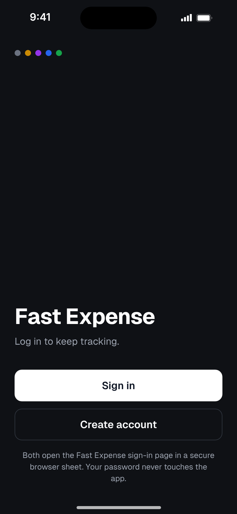

- Email + password form → one "Sign in" button. Spec 0009: the app signs in through a system browser sheet on the same /login page (OAuth 2.1 + PKCE).
- Kept the dark single-column shell, five card dots, title and "Log in to keep tracking."
- "Sign up" link → "Create account" button. Opens /signup in the same sheet.
- No Sign in with Apple, Google, passkeys or Face ID. Out of scope in spec 0009 (replaces the earlier iOS draft).

Source: 01-current-screens/login-mobile.png · Brief 13

## Browser sheet · /login

`Kept`

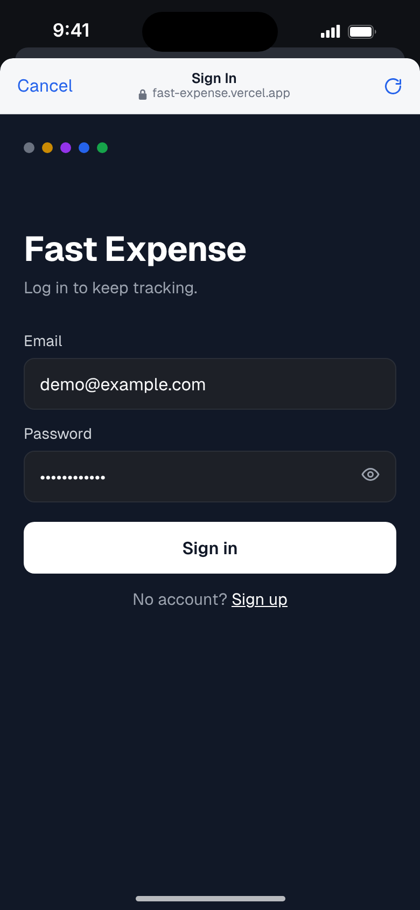

- The live web login page, unchanged, shown inside the iOS sign-in sheet (ASWebAuthenticationSession).
- System chrome only: Cancel, the lock and host, reload. Host name is a placeholder.

Source: 01-current-screens/login-mobile.png

## Browser sheet · wrong password

`Kept`

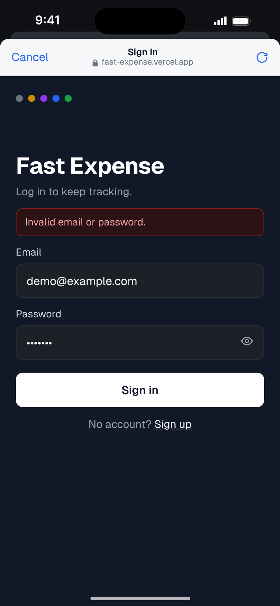

- Same web error copy: "Invalid email or password." The app does nothing until the sheet returns.

Source: 05-future-screens.md · Brief 13 states

## Browser sheet · consent

`New · Brief 13`

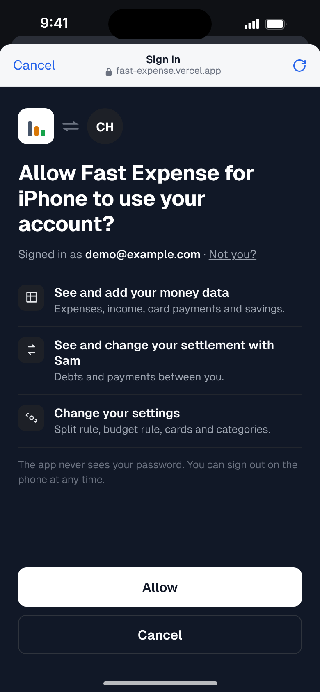

- CHORE-42 / ADR-0028. New page in the existing auth shell: app name, signed-in email, what it can access, Allow / Cancel.
- Allow → redirect back to the app with a one-time code; the app then calls /api/v1.
- Cancel → back to the launch screen with a "Sign-in was cancelled." banner (inferred).
- Access list wording is a proposal; scopes come from the PR 5 API.

Source: 05-future-screens.md · Brief 13

## Session ended

`New · Brief 13`

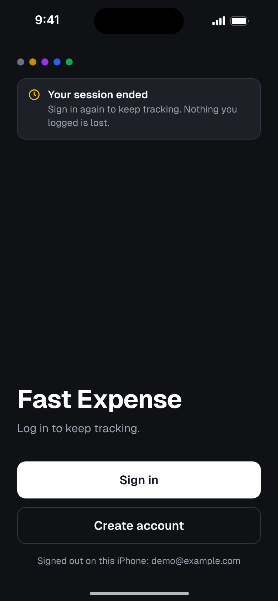

- Access token 1 h, refresh 30 d. Refresh is silent; this screen only shows when the refresh token is gone or revoked.
- Proposal copy. Data stays on the server, so nothing is lost.

Source: 05-future-screens.md · Brief 13 (session expiry)

## Browser sheet · /signup

`Kept`

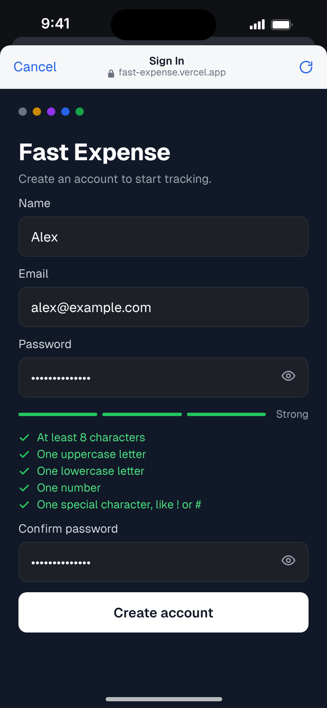

- The live signup page, unchanged, with its strength meter and live checklist.
- After Create account the sheet closes through consent and the app opens native onboarding.

Source: 03-onboarding/00-signup-filled-mobile.png

## 1 · Welcome

`Kept`

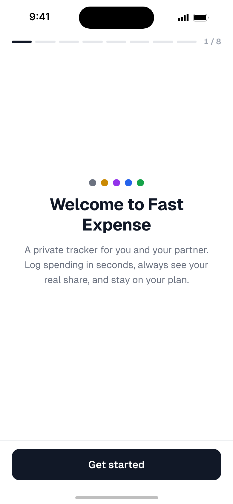

- Same copy, dots and single CTA. The bottom bar sits above the home indicator (safe area).

Source: 03-onboarding/01-welcome-to-fast-expense-mobile.png

## 2 · Name

`Adjusted`

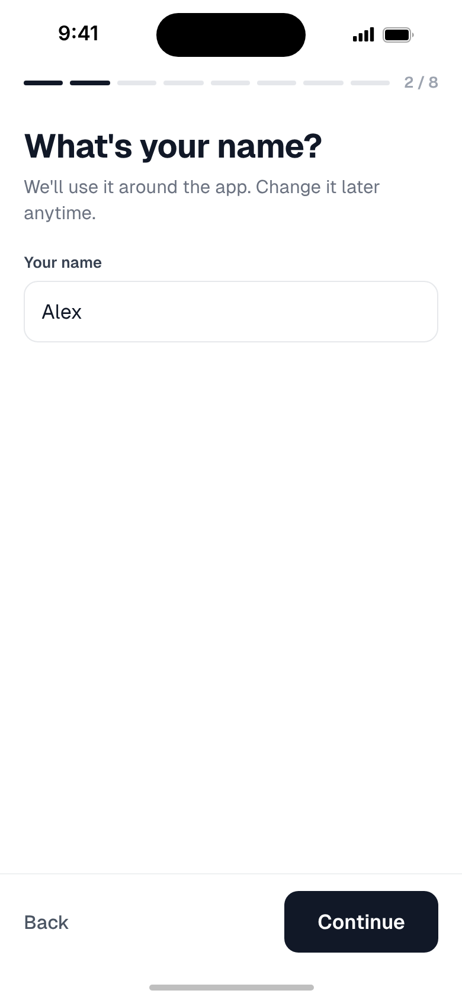

- Keyboard opens on appear; Return = Continue.
- Back also by edge swipe. Native navigation stack.

Source: 03-onboarding/02-what-s-your-name--mobile.png

## 3 · Share expenses

`Kept`

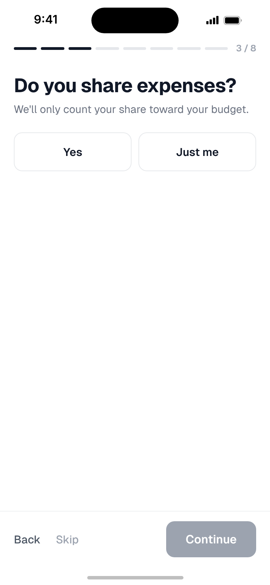

- Same two choices; Continue stays disabled until one is picked, as on the web.

Source: 03-onboarding/03-do-you-share-expenses--mobile.png

## 3 · Share expenses · Yes

`Adjusted`

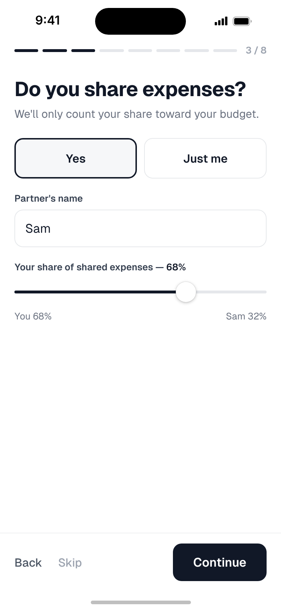

- Web range input → native slider with haptic ticks every 5%.
- Fields appear in place when Yes is picked (desktop shows them; phone screenshot was the empty state). Web default is 50%; shown at 68% to match the demo data.

Source: 03-onboarding/04-sharing-yes-desktop.png

## 4 · Monthly income

`Adjusted`

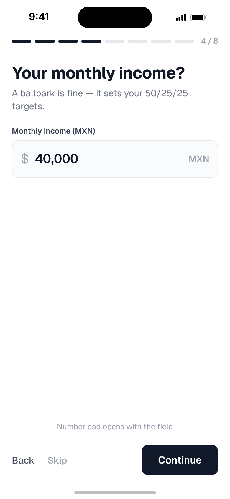

- Text field → decimal number pad with $ prefix and MXN suffix kept.

Source: 03-onboarding/04-your-monthly-income--mobile.png

## 5 · Budgeting rule

`Kept`

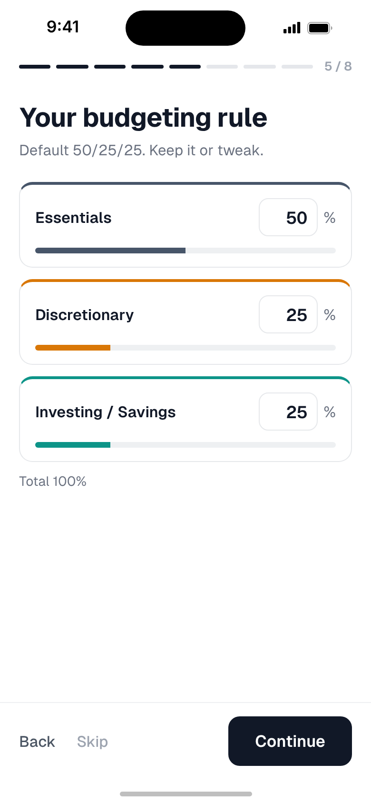

- Same three bucket cards, colours, % fields, bars and "Total 100%". Fields use the number pad.

Source: 03-onboarding/05-your-budgeting-rule-mobile.png

## 6 · Payment method

`Adjusted`

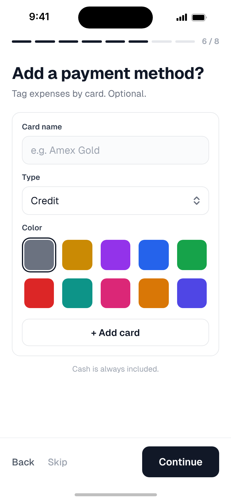

- Type select → native menu picker. Same Credit/Debit options.
- Same 10 swatches, bigger hit targets (44 pt).

Source: 03-onboarding/06-add-a-payment-method--mobile.png

## 7 · Categories

`Kept`

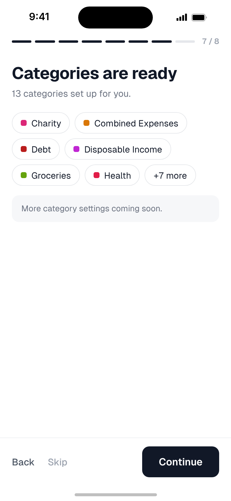

- Same chips and "+7 more".
- When Brief 6 ships the grey note changes to point at Settings → Categories.

Source: 03-onboarding/07-categories-are-ready-mobile.png

## 8 · All set

`Kept`

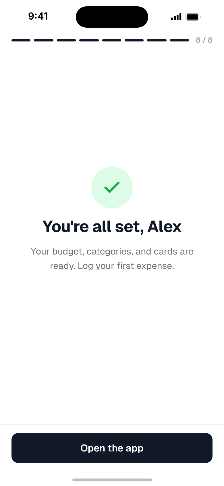

- "Open the app" lands on Dashboard with the Add sheet opened on Expense, so the first log is one step away.

Source: 03-onboarding/08-you-re-all-set-alex-mobile.png
