# Dashboard

Exported from the FET design canvas, page "iOS app 2 Dashboard". iPhone 390×844 pt, PNG @2x (780×1688).

Badges: **Kept** = same as the web phone view · **Adjusted** = same content, native changes · **New** = planned feature (brief) · **Proposal** = inferred, needs a decision.

## Dashboard · top

`Adjusted`

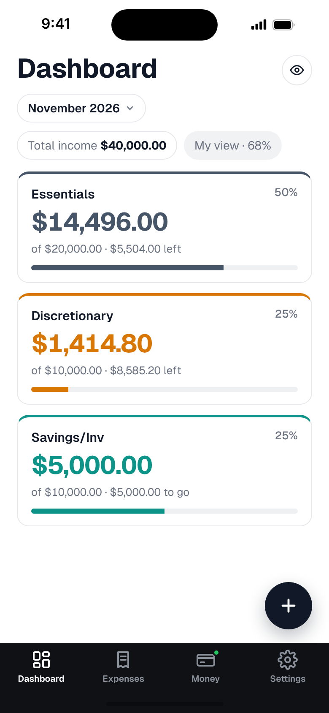

- Dark top bar + burger → dark tab bar. Keeps the sidebar's dark surface; one tap between the four areas.
- "November 2026" heading → large title "Dashboard". The month moves into the pill so the title never changes.
- ‹ date input › → month pill. Tap opens a wheel picker; swipe the header left/right for prev/next month.
- "+ Add" button → floating +. Brief 4 and the V1 mobile mock; reachable with the thumb on every list.
- Eye button added. Brief 1 global hide toggle (see "Amounts hidden").
- Pull to refresh. Replaces reloading the page.

Source: 01-current-screens/dashboard-mobile.png

## Dashboard · scrolled 1

`Kept`

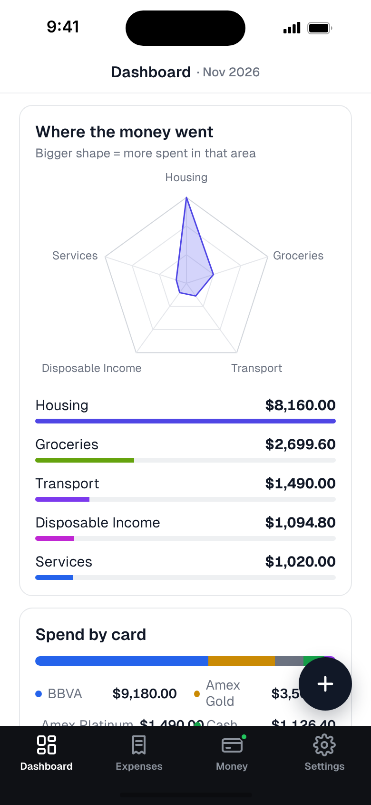

- Kept as the web phone view. Radar, the five category bars and Spend by card in the same order; the collapsed nav title keeps the month in view while scrolling.
- Tap a category bar to push its detail screen; long-press the radar for exact values.

Source: 01-current-screens/dashboard-mobile.png

## Dashboard · scrolled 2

`Adjusted`

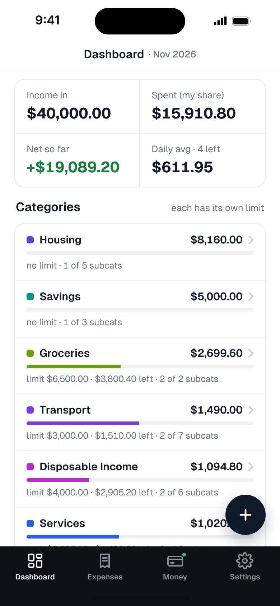

- Stat grid kept 2×2. Same four figures and labels.
- Category cards → one grouped list with chevrons. Same order, amount, bar and limit line; rows push Category detail. Health, Combined Expenses and Personal follow below.
- Inline limit edit → limit sheet. Long-press a row → "Set monthly limit" (same path as the category screen's pencil).

Source: 01-current-screens/dashboard-mobile.png

## Dashboard · month rail

`Adjusted`

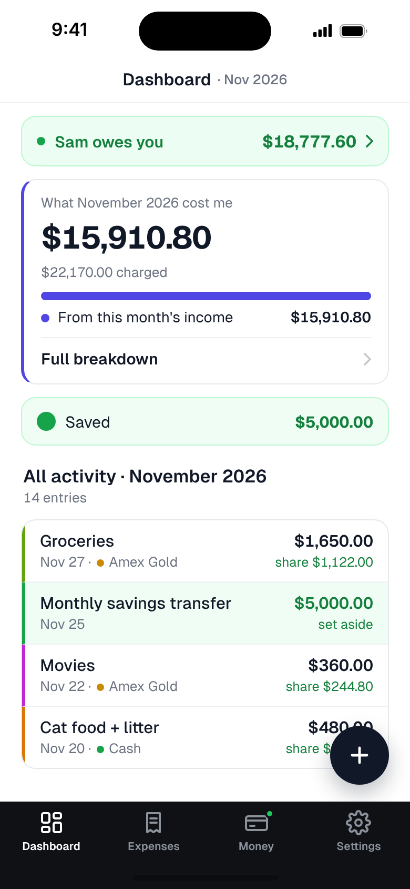

- Desktop month rail → stacked section. Sam pill, "What November 2026 cost me", Saved and All activity sit after the categories, in the rail's order.
- Sam owes you pill pushes Settlement (inside the Money tab), as the web pill links to /settlement.
- Full breakdown modal → page sheet (see Sheets row).
- Feed scroll box → part of the page scroll. No nested scrolling on a phone; tap a row to edit it in the Add sheet.

Source: dashboard-mobile.png · dashboard-full-breakdown-desktop.png (rail) · 04-design-mocks/built-summary-mix.png

## Dashboard · all activity

`Kept`

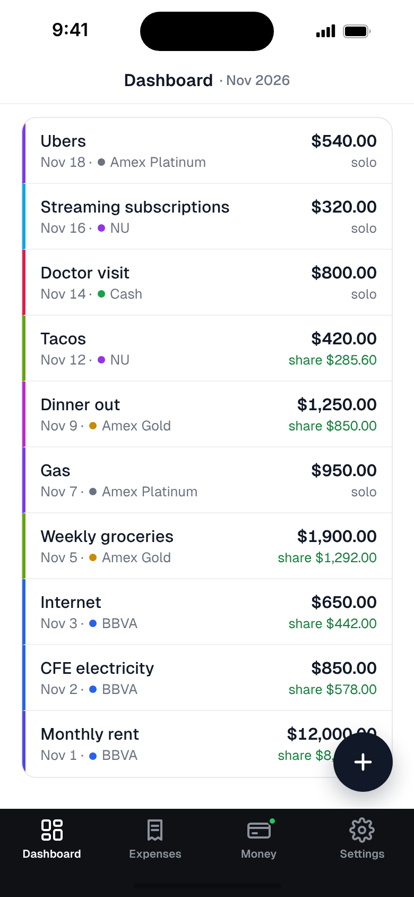

- Kept. Same rows, rails, card dots and "share / solo" labels as the web feed; dates drop the year because the month is pinned in the nav title.

Source: 01-current-screens/dashboard-mobile.png

## Dashboard · amounts hidden

`New · Brief 1`

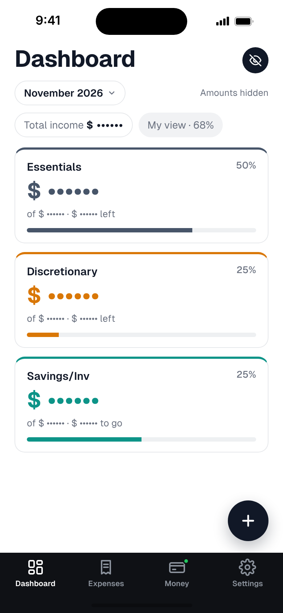

- Slice 2.8 · P12. One eye toggle masks every money figure app-wide: dashboard, Income, Expenses, Money, sheets.
- Masked format $ •••••• ; percentages, bars and charts keep their shape.
- State persists across tabs and launches; the default comes from Settings › Privacy ("Hide sensitive amounts by default").
- Native add: amounts auto-hide in the app switcher snapshot (inferred in the brief).

Source: 05-future-screens.md Brief 1 · Income "Hide" in confirmed-v1 · Settings.html Privacy

## Weekly summary card

`Proposal · Brief 5`

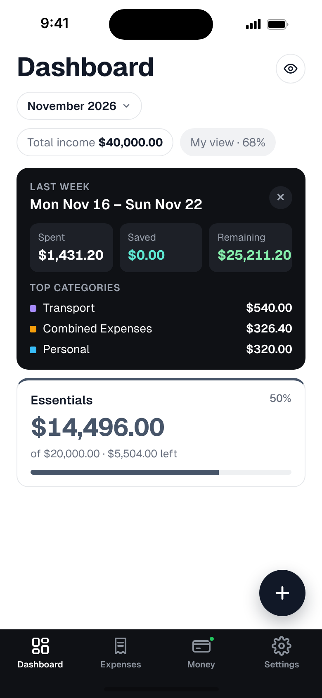

- Slices 7.1–7.4 are an email on web. Proposal: the same content as an in-app card on Dashboard, shown on the user's email day (default Monday) until dismissed, plus an optional push.
- Content follows the brief: Spent (my share), Saved, Remaining, top 3 categories, Mon–Sun week in CDMX time. No settlement nudge, no logging reminder.
- Remaining = November income minus what was counted through Nov 22. Day picker and Off live in Settings (page 5).
- Dark card uses the nav surface so it reads as a notice, not as a fourth bucket.

Source: 05-future-screens.md Brief 5 · no mock

## Month picker · sheet

`Adjusted`

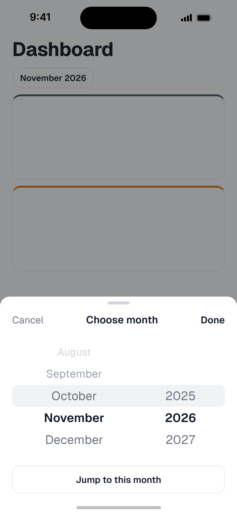

- ‹ arrows + dd/mm/yyyy calendar input → native month/year wheel in a medium sheet; a day picker is not needed to choose a month.
- Prev/next arrows → swipe the header. The same pill and picker sit on Expenses, Income, Card balances and Settlement.
- "Jump to this month" replaces typing today's date.

Source: 01-current-screens/dashboard-mobile.png (date control)

## November 2026 breakdown · sheet

`Adjusted`

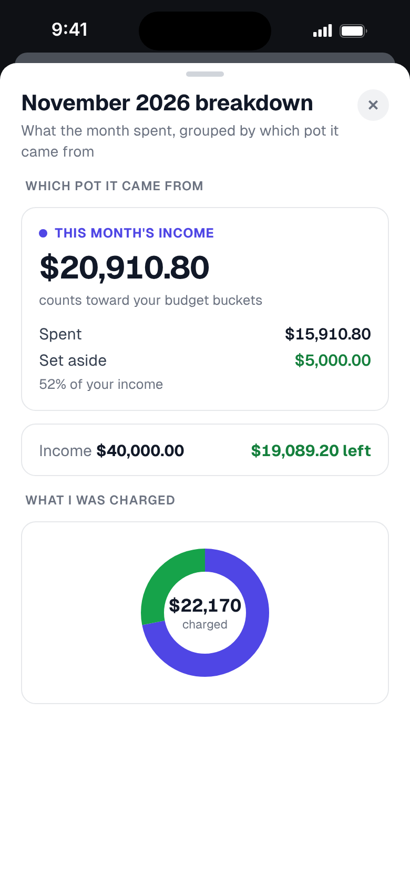

- Centered modal → large page sheet with grabber; swipe down or ✕ to close.
- Desktop two-column layout → one column. Pot card, income line, then the charged donut, in the modal's order.
- Opens from "Full breakdown" on the Dashboard rail and from the Expenses summary chin.

Source: 02-current-states/dashboard-full-breakdown-mobile.png · -desktop.png

## Breakdown · scrolled

`Kept`

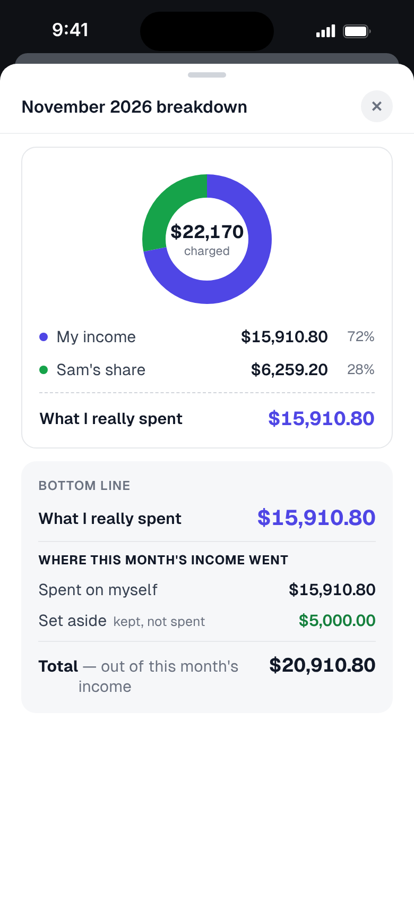

- Kept. Donut with "$22,170 charged", My income vs Sam's share with percents, What I really spent, and the Bottom line block with the same rows.
- Legend moves under the donut (one column on a phone).

Source: 02-current-states/dashboard-full-breakdown-desktop.png

## Category · Groceries

`Adjusted`

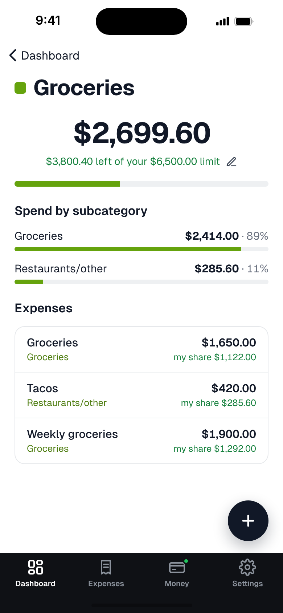

- ‹ back link → native nav bar "‹ Dashboard" with edge-swipe back.
- Pencil opens the limit sheet instead of an inline dialog.
- Expense card rows → tappable list rows that open the Edit sheet; swipe left to delete.
- Floating + prefills Groceries as the category.

Source: 01-current-screens/category-groceries-mobile.png

## Category · Housing (no limit)

`Adjusted`

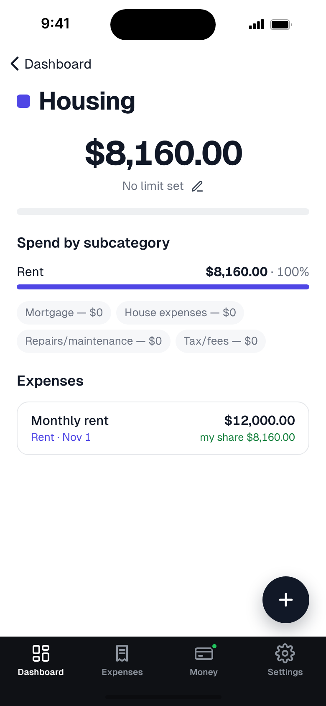

- Empty subcategories ($0) → small grey chips. Same text; they wrap cleanly on a narrow screen.
- "No limit set" + pencil kept; the pencil opens the same limit sheet.
- Row date added under the subcategory, since the web card hides it on phone.

Source: 01-current-screens/category-housing-mobile.png

## Monthly limit · Groceries · sheet

`Adjusted`

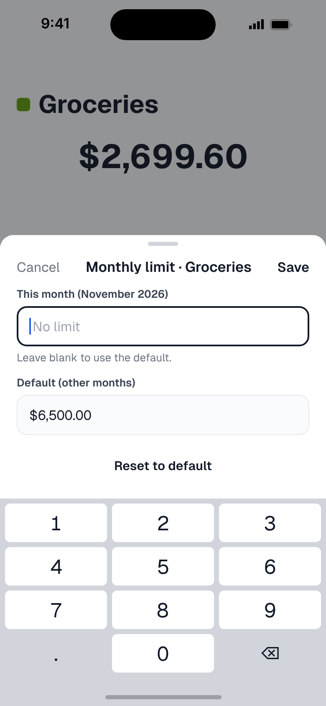

- Dialog → medium sheet that rises with the decimal pad.
- "Save" button → nav-bar Save; Cancel added on the left, ✕ removed.
- Same two fields, helper text and "Reset to default"; amounts shown formatted ($6,500.00).

Source: 02-current-states/category-edit-limit-mobile.png

## Category · show full amounts

`New · Brief 9`

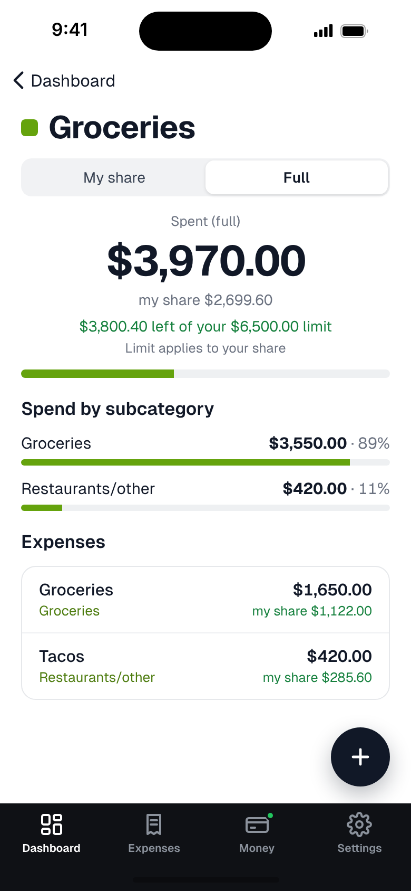

- CHORE-30 · P29. "Show full amounts" as a native segmented control My share | Full under the title; hidden in solo mode.
- Full view: hero reads "Spent (full)" $3,970.00 with my share under it; subcategory bars and percents use full amounts.
- Limit, Remaining and the bar stay my-share, with "Limit applies to your share". Expense list unchanged; savings-funded rows stay out of both views.
- Choice is remembered per category screen (web keeps it in ?view=full).

Source: 05-future-screens.md Brief 9 · no mock

## Plan · December 2026

`Proposal · Brief 8`

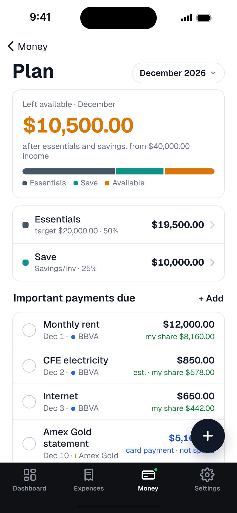

- Proposal for the brainstorm. Covers the four asks: essentials, payments due, how much to save, what is left.
- Lives as a "Plan" row at the top of the Money hub. Planning next month is about where money goes, which is Money's job; Dashboard stays the read-out of the current month.
- Starts from the budget rule (50/25/25 of $40,000.00); the user nudges Essentials and Save, "Left available" follows.
- Shared bills show the full charge and my share; the card statement is blue because a card payment is not spending.
- Ticking a due payment offers to log it (expense or card payment) — nothing is logged by planning alone.

Source: 05-future-screens.md Brief 8 · no mock

## Add a due payment · sheet

`Proposal · Brief 8`

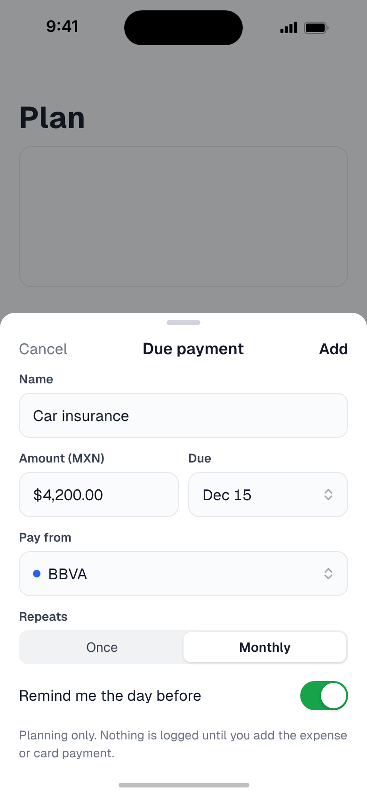

- Proposal. Same field look as the Add sheet; native date and card pickers.
- "Remind me" maps the brief's "due payments could map to reminders" to a local notification — push is out of scope in spec 0001, so this stays on-device.
- Data model, recurrence and whether reminders ship are open for the brainstorm.

Source: 05-future-screens.md Brief 8 · no mock
