# Expenses & Add

Exported from the FET design canvas, page "iOS app 3 Expenses and Add". iPhone 390×844 pt, PNG @2x (780×1688).

Badges: **Kept** = same as the web phone view · **Adjusted** = same content, native changes · **New** = planned feature (brief) · **Proposal** = inferred, needs a decision.

## Expenses · top

`Adjusted`

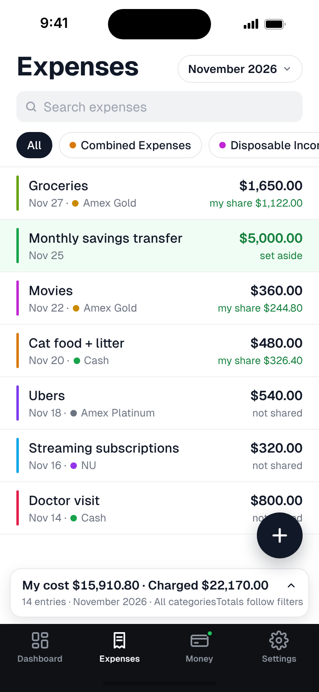

- Burger + dark header → tab bar. Expenses is its own tab; the dark sidebar surface becomes the dark tab bar.
- ‹ November 2026 📅 › → month pill. Tap for a month wheel; swipe the header left/right for prev/next month.
- Filter chips → one scrolling row. Same chips and order as the web (All + the 9 categories with spend); wrapping took 4 rows on a phone.
- Pencil and trash icons removed. Tap a row to edit; swipe for Edit/Delete. Frees width so card names stop truncating ("A…").
- Summary chin pinned above the tab bar. Same text and order as the web chin; tap or drag up to expand.
- + Add → floating + button. Brief 4 FAB; sits above the chin so it never covers a total.
- Search field added (native .searchable). Harmless addition, hidden until pulled down; matches description and notes.

Source: 01-current-screens/expenses-mobile.png

## Expenses · scrolled to the end

`Adjusted`

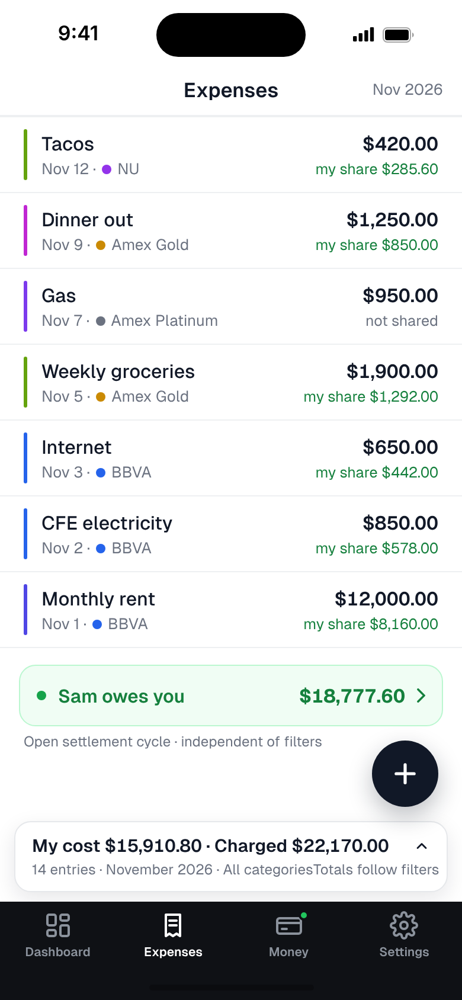

- Large title collapses to an inline title. Standard iOS scroll behaviour; month stays visible on the right.
- Sam owes you row kept at the end of the list. Same label, figure and caption; tap pushes Settlement inside the Money tab.
- Rent and services rows unchanged. Full charge on top, "my share" in green under it.

Source: 01-current-screens/expenses-mobile.png (bottom)

## Summary chin · expanded

`Adjusted`

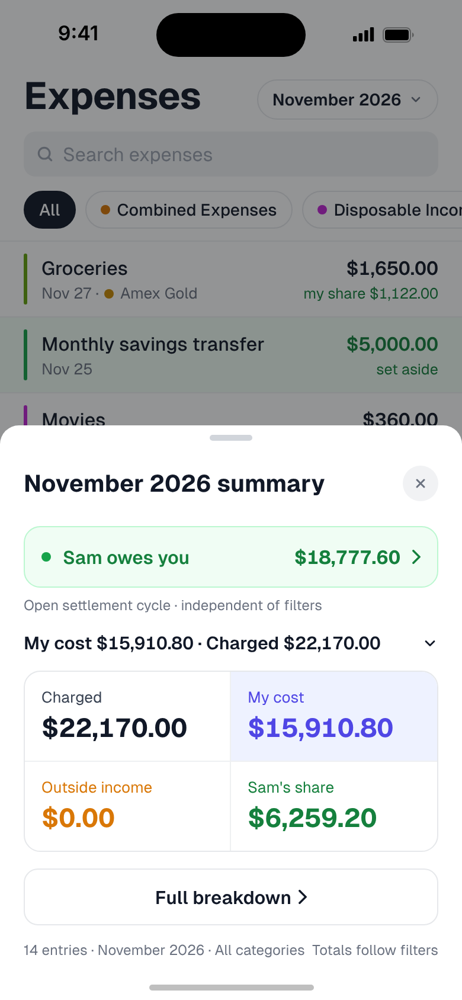

- Expanding chin → medium-detent sheet. Same four tiles, colours and order; drag down or ✕ to collapse.
- Sam owes you row moved into the sheet top. On web it sits above the chin; on a phone the sheet is where you look next.
- Full breakdown › opens the Breakdown sheet. Same sheet as the Dashboard (page 2).

Source: 02-current-states/expenses-summary-expanded-mobile.png

## Filter · Groceries

`Kept`

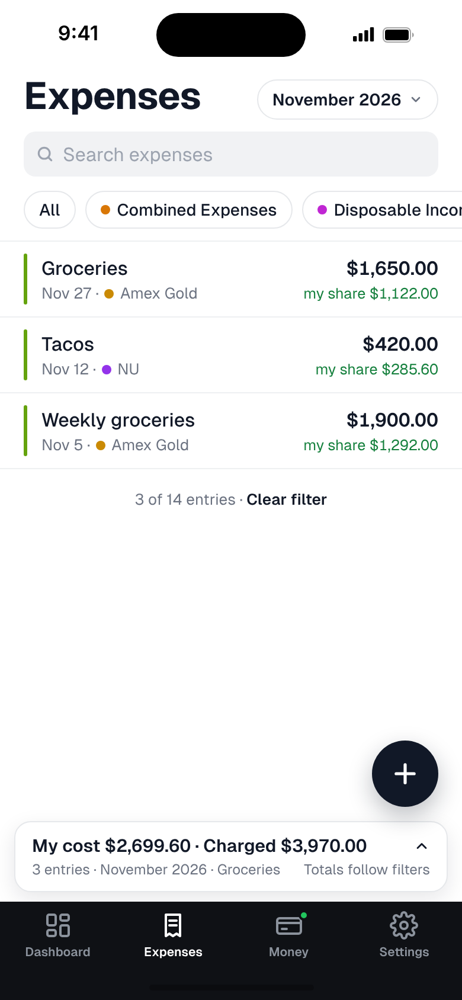

- Kept. Same filter logic as the web: chips filter the list and the chin totals follow; Sam owes you stays independent of filters. Selected chip scrolls into view.

Source: 01-current-screens/expenses-mobile.png (filter chips)

## Swipe actions · delete confirm

`Adjusted`

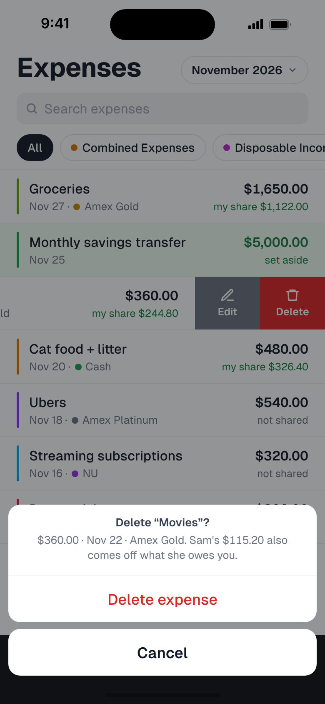

- Row icons → swipe actions. Swipe left reveals Edit and Delete; a full swipe left deletes. Same two actions as the web icons.
- Delete asks first (action sheet). Web deletes from a trash icon; a swipe is easier to trigger by accident.
- Settlement line in the confirm (proposal). Spells out that Sam's 32% leaves the open settlement cycle with it.

Source: 01-current-screens/expenses-mobile.png (row actions)

## Add menu · sheet

`Adjusted`

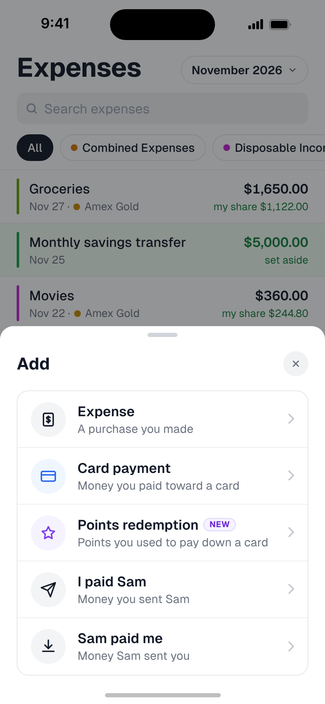

- Full-screen dialog → medium-detent sheet. Opened by the + button from any tab; the screen stays visible behind it.
- Same four entries, labels and subtitles. Expense, Card payment, I paid Sam, Sam paid me, in the web order.
- Points redemption added (Brief 7, CHORE-24). Sits beside Card payment as the brief asks; violet = redemption colour.
- Long-press + skips this sheet. Goes straight to Expense, the most common action.

Source: 02-current-states/expenses-add-menu-mobile.png · dashboard-add-menu-mobile.png

## Add expense · empty

`Adjusted`

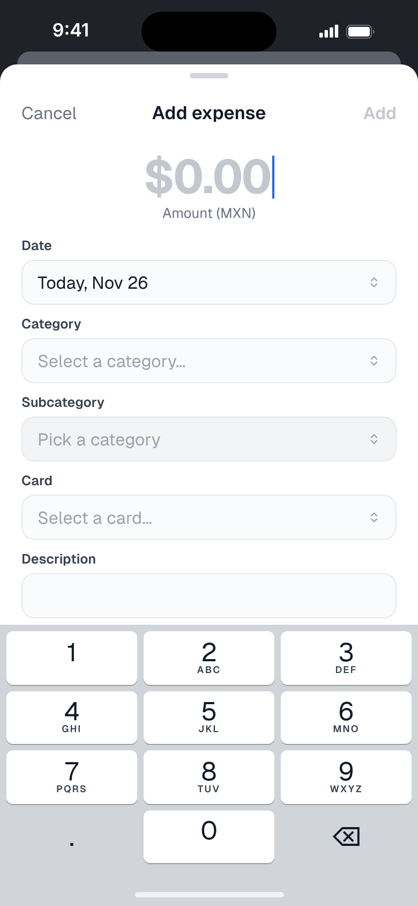

- Dialog → large sheet; buttons → nav bar. "Cancel" left, "Add" right (greyed until amount, category and card are set). Same required fields.
- Amount moved first, decimal pad open. Fastest capture: type the number, then pick. Web order was Date, Amount, …
- dd/mm/yyyy → "Today, Nov 26". Native date picker; defaults to today like the web.
- Selects → pushed picker lists. Category shows colour dots grouped by bucket (next frames).
- Description, Notes and both checkboxes sit below the pad. Shown in the filled frame.

Source: 02-current-states/expenses-add-expense-form-mobile.png

## Add expense · filled, shared

`Adjusted`

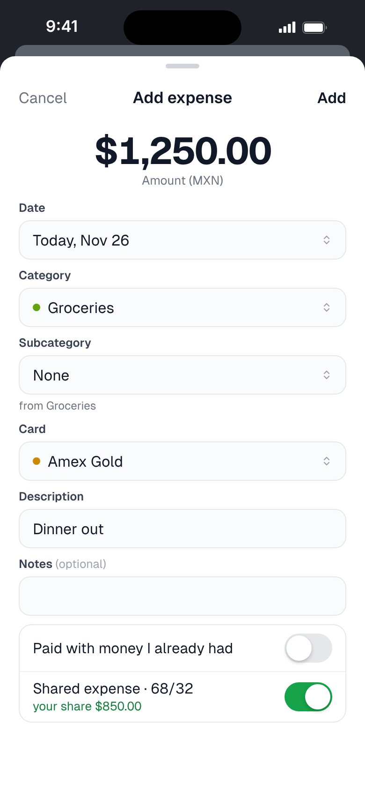

- Checkboxes → iOS switches. Same two options and labels; "your share $850.00" stays green under the shared switch.
- Notes textarea → one-line field that grows. Saves height on a phone.
- Add expense / Cancel buttons → nav bar. Always reachable with the keyboard up.

Source: 02-current-states/expenses-add-expense-filled-mobile.png

## Category picker · pushed in the sheet

`Adjusted`

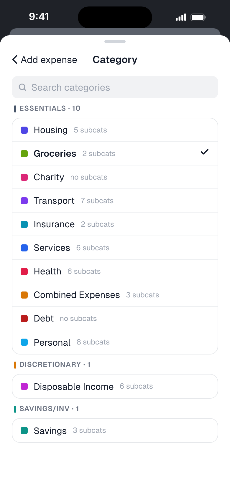

- <select> → pushed list inside the sheet. Room for colour dots, a search field and a checkmark; back returns to the form.
- Grouped by bucket (Essentials / Discretionary / Savings/Inv). Same grouping and bucket colours as Settings › Categories (mock 1a), so you see where a spend counts.
- Subcategory picker works the same. Opens after a category with subcategories; "None" is the first row.

Source: 02-current-states/expenses-add-expense-filled-mobile.png (Category select) · 04-design-mocks/future-category-management.png

## Edit expense

`Adjusted`

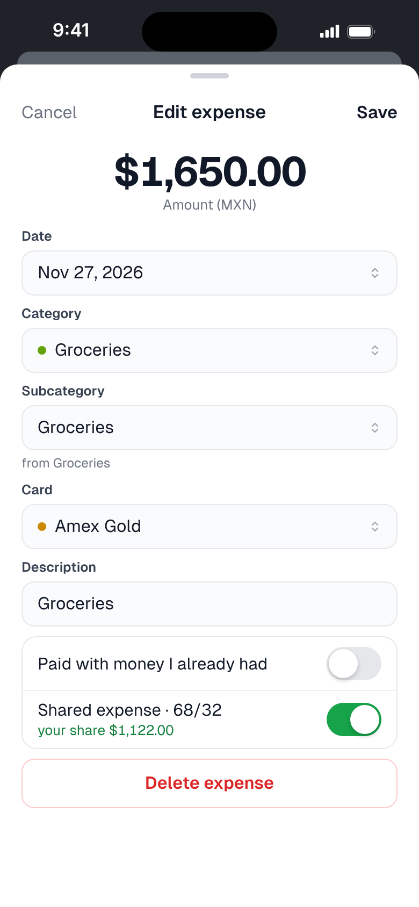

- Same form as Add, prefilled. Title "Edit expense", nav-bar action "Save" (web: "Save changes").
- 27/11/2026 → "Nov 27, 2026". Native date display.
- Delete expense added at the bottom. Web deletes from the list row; on iOS the row icons are gone, so delete also lives here. Notes field scrolls below.

Source: 02-current-states/expenses-edit-expense-mobile.png

## Card payment

`Adjusted`

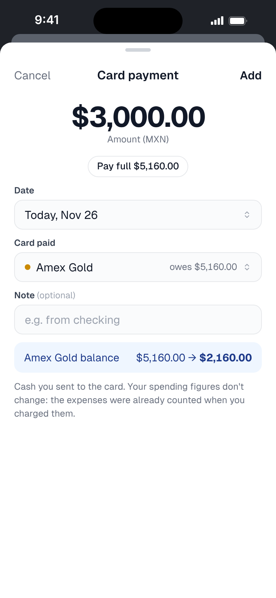

- Dialog → large sheet; amount first. Same fields: Date, Amount, Card paid, Note (optional).
- "Pay full $5,160.00" chip kept. Appears once a card is picked (from the Cards log-payment form).
- Blue balance preview + copy kept. Card payment colour #2563eb on #eff6ff; never reads as spend.
- Card picker shows what each card owes. Same figure the Card balances screen shows.

Source: 02-current-states/expenses-card-payment-form-mobile.png · cards-log-payment-mobile.png

## I paid Sam

`Adjusted`

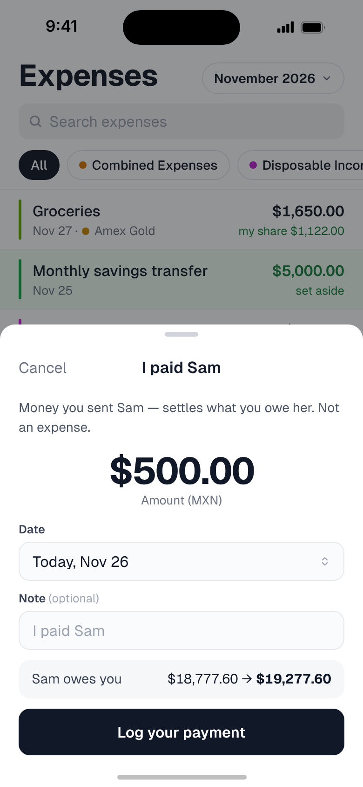

- Menu entry → medium sheet. Same entry and subtitle as the web Add menu; Cancel in the header, one primary button at the bottom.
- Settlement-only form (copy proposal). Mirrors "Sam paid me": Date, Amount, Note. Wording follows the web help ("Record payment … will say I paid Sam").
- Balance preview (proposal). Shows how the running balance moves before you log it.

Source: 02-current-states/expenses-add-menu-mobile.png · settlement-help-mobile.png

## Sam paid me · Record payment

`Adjusted`

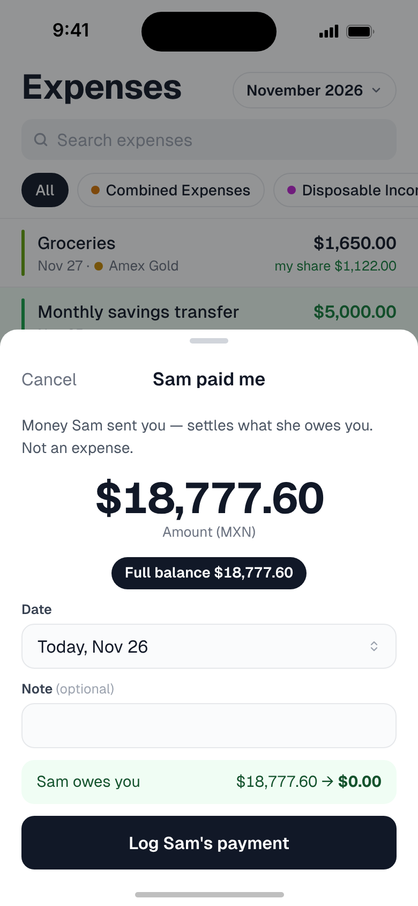

- Dialog → medium sheet. Same copy, fields and button label "Log Sam's payment".
- 18777.6 → "$18,777.60". Amount is formatted as you type (number pad).
- "Full balance" chip (proposal). The web pre-fills the balance; the chip makes that visible and reversible.
- Settlement › Record payment opens the same sheet. One form for both entry points.

Source: 02-current-states/settlement-record-payment-mobile.png

## Recurring · switch on the form

`New · Brief 2`

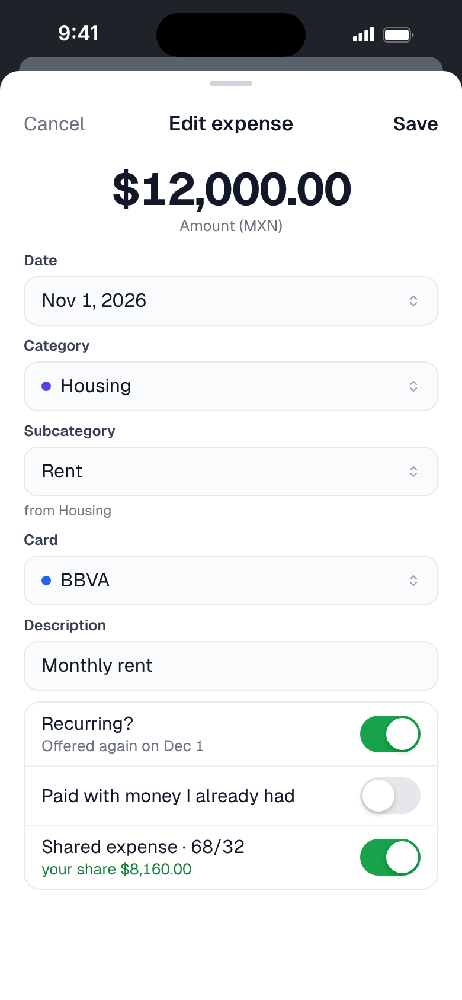

- Slice 3.1 (P13). "Recurring?" switch, off by default; shown on for Monthly rent.
- Caption "Offered again on Dec 1" (proposal). Says what the switch will do in plain words.
- Placed first in the switch group. It applies to every expense type; the shared switch keeps its share line.

Source: 05-future-screens.md · Brief 2

## Recurring · badge on rows

`New · Brief 2`

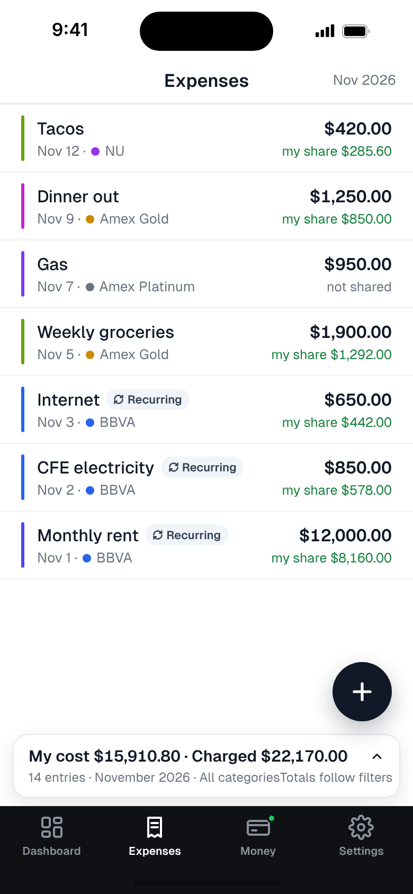

- Slice 3.1 list row badge. "Recurring" pill after the title; grey so it never competes with the green share line.
- Same rows and totals. The badge changes no figure.

Source: 05-future-screens.md · Brief 2

## Recurring · month rollover sheet

`New · Brief 2`

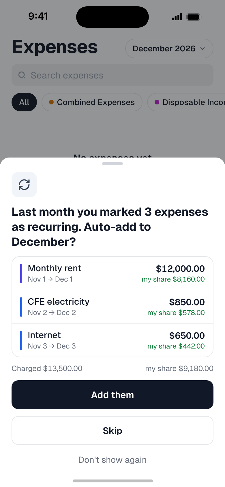

- Slices 3.3 + 3.4. Modal → bottom sheet with a preview of the rows it will copy, as the brief suggests.
- Fires once per user and month, on the first visit to December; Skip marks the month prompted; "Don't show again" sets the Settings toggle.
- Dates move +1 month (Jan 31 → Feb 28). Shown per row so nothing is a surprise. Totals line is a proposal.

Source: 05-future-screens.md · Brief 2

## Recurring · after "Add them"

`New · Brief 2`

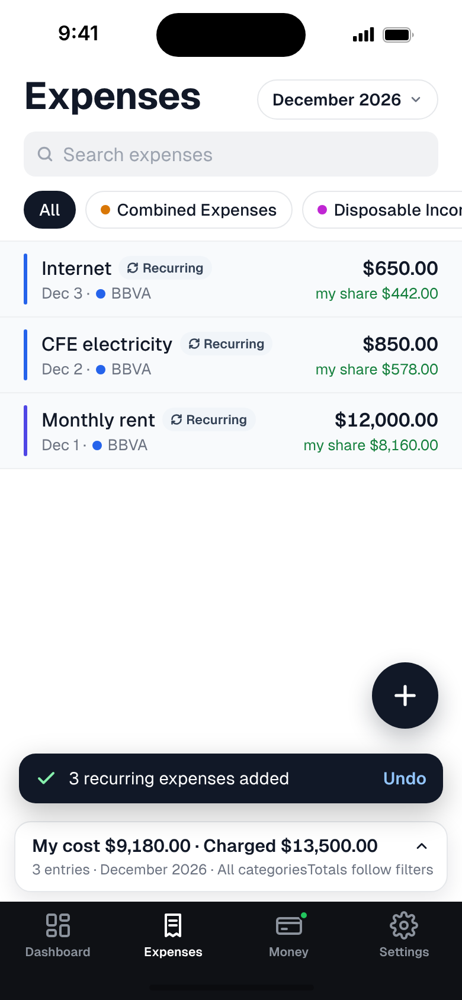

- Cloned rows reveal with a stagger fade. Light tint for 2 s, then normal rows; each is editable (tap) like any expense.
- Chin totals update at once. Same chin, now for December.
- Toast with Undo (proposal). Not in the brief; cheap safety net for a one-tap bulk add.

Source: 05-future-screens.md · Brief 2

## Multi-currency · USD expense

`New · Brief 3`

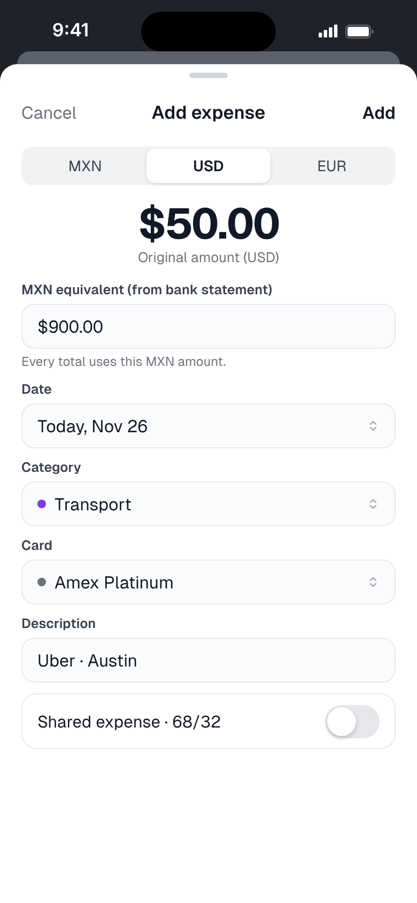

- Slice 5.1 (P26). Currency as a segmented control above the amount (brief's mobile note).
- Non-MXN: hero = Original amount (required); the existing amount field is relabelled "MXN equivalent (from bank statement)".
- Totals stay in MXN. Helper line says so; the original amount is reference only.

Source: 05-future-screens.md · Brief 3

## Multi-currency · validation error

`New · Brief 3`

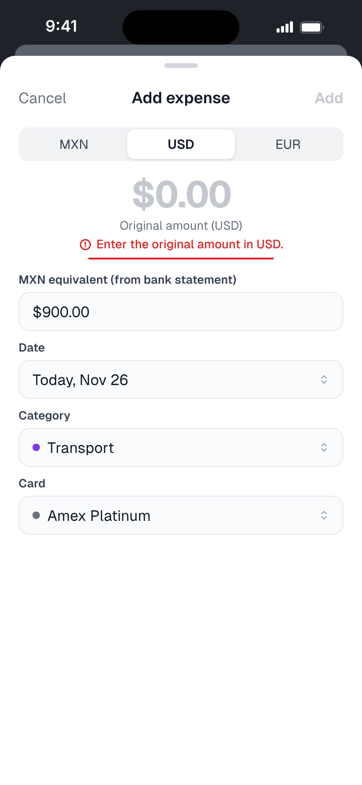

- Slice 5.1 validation. Currency is USD/EUR and the original amount is empty → inline error, "Add" stays disabled.
- Error copy (proposal). Names the currency so the fix is obvious.

Source: 05-future-screens.md · Brief 3

## Multi-currency · list row

`New · Brief 3`

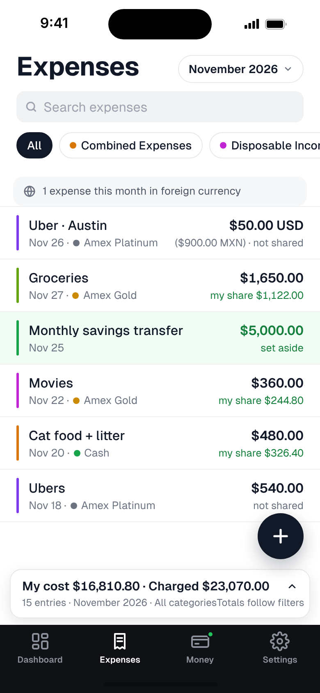

- Slice 5.2 (P27). Row shows "$50.00 USD" with "($900.00 MXN)" under it; MXN-only rows unchanged.
- Two lines instead of one. "$50.00 USD ($900.00 MXN)" does not fit the right column at 390 pt.
- Foreign-currency note (proposal). The brief leaves it to the slice; shown as a quiet line above the list.
- Chin adds the MXN amount. $15,910.80 + $900.00 = $16,810.80; $22,170.00 + $900.00 = $23,070.00.

Source: 05-future-screens.md · Brief 3

## Partial reimbursement · form

`New · Brief 12`

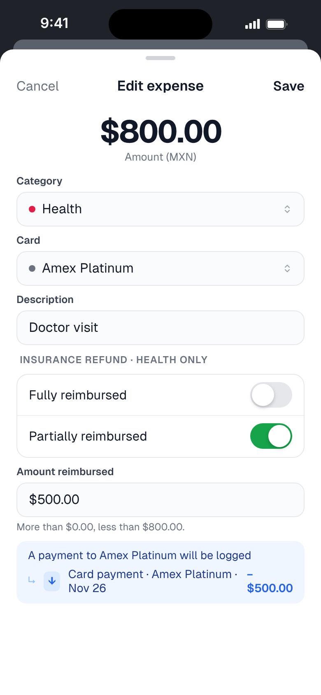

- CHORE-38 (P38). "Fully reimbursed" stays; "Partially reimbursed" added with an amount. The two switches are exclusive.
- Note names the card: "A payment to Amex Platinum will be logged". Cash expenses show no linked payment.
- Linked payment as a sub-row (brief's mobile note). Dated the save day; changes with the amount, goes away when unchecked.
- Date, Subcategory, Notes and the shared switch scroll above/below. Cropped here to show the new part.

Source: 05-future-screens.md · Brief 12

## Partial reimbursement · list

`New · Brief 12`

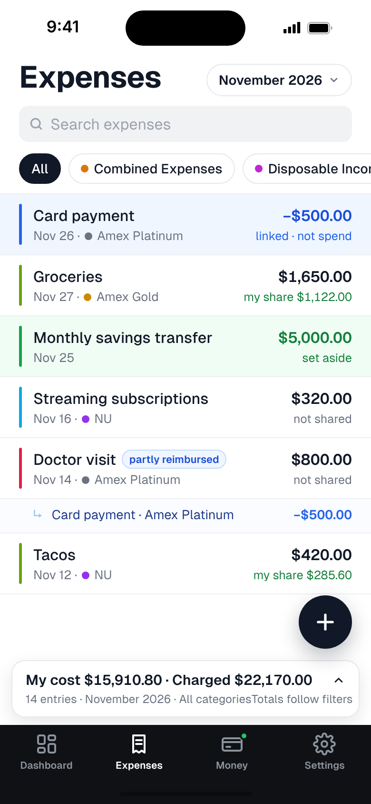

- Distinct pill "partly reimbursed". Blue (card-payment family) so it does not read like the full "reimbursed" badge.
- Linked payment shown twice, by design: as a sub-row under the expense, and as its own blue card-payment row on the save day.
- Budget and chin figures unchanged here. How the refund counts is decided in the ADR; not shown until then.

Source: 05-future-screens.md · Brief 12

## Optimistic rows · offline

`New · Brief 4`

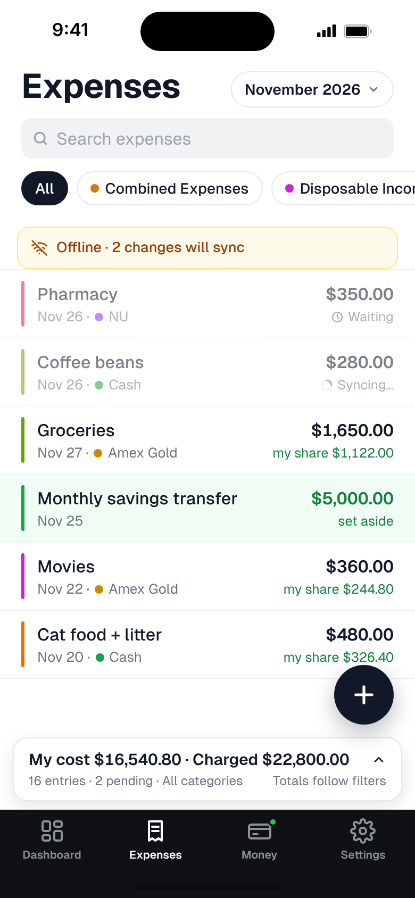

- Slice 6.3 (P19). A saved row appears at once with a pending look (55% opacity) and a status in place of the share line.
- Offline queue + banner (proposal, brief's mobile note). "Offline · 2 changes will sync"; rows show "Waiting", then "Syncing…".
- Totals include pending rows. The chin counts them and says "2 pending"; the server still does the money maths.

Source: 05-future-screens.md · Brief 4

## Optimistic rows · failed + rollback

`New · Brief 4`

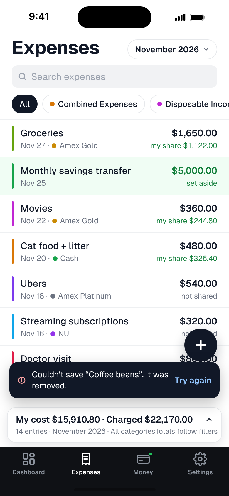

- Slice 6.3 failure path. The row rolls back out of the list and the chin returns to the confirmed totals.
- Toast with "Try again" (copy proposal). Re-opens the Add sheet prefilled; the toast sits above the chin and FAB moves up.
- Touch targets ≥ 44 pt (6.5 audit). Rows 64 pt, chips 32 pt with 44 pt hit area.

Source: 05-future-screens.md · Brief 4
