# Money

Exported from the FET design canvas, page "iOS app 4 Money". iPhone 390×844 pt, PNG @2x (780×1688).

Badges: **Kept** = same as the web phone view · **Adjusted** = same content, native changes · **New** = planned feature (brief) · **Proposal** = inferred, needs a decision.

## Money

`Adjusted`

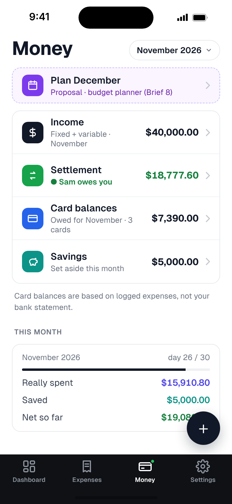

- Sidebar Money group → its own tab. Income, Settlement, Card balances and Savings sit one tap from the tab bar instead of a burger drawer.
- Each row carries its headline number. Most checks end here; tap pushes the full screen.
- Sidebar "This month" panel → card at the bottom. Same three figures (Really spent, Saved, Net so far) and day 26/30 bar, full precision.
- Settlement badge → green dot on the Money tab. iOS tab badges are dots or counts; the amount shows in the row.
- "+ Add" → FAB. Brief 4; opens the Add sheet.

Source: 02-current-states/nav-drawer-mobile.png

## Income

`Kept`

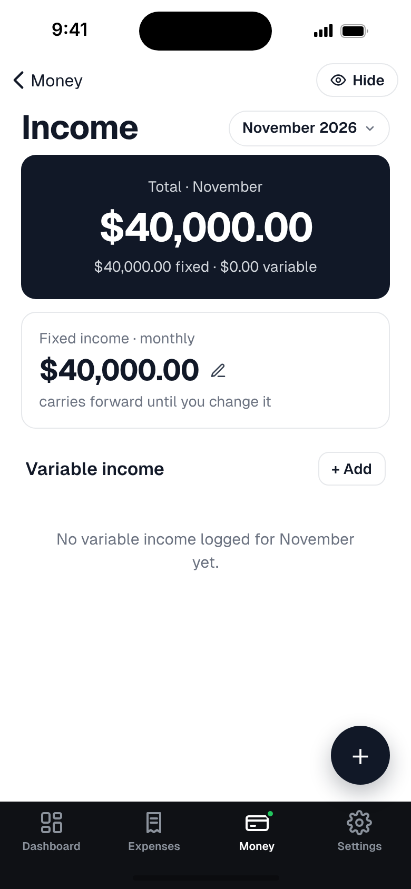

- Kept. Same order: Hide toggle, dark total card, fixed income with pencil, Variable income + Add, empty state.
- Month control → month pill; burger header → back to Money. Native navigation only; no content change.

Source: 01-current-screens/income-mobile.png

## Income · amounts hidden

`Adjusted`

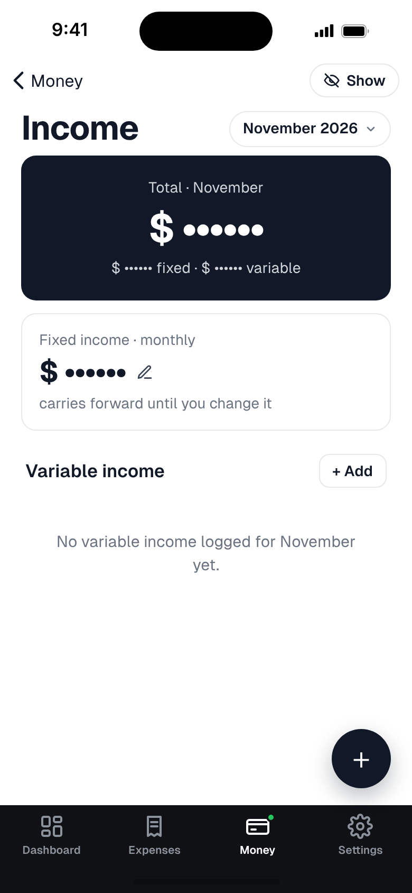

- Hide → masks every figure as "$ ••••••". Same Hide/Show button the web has; label flips to Show.
- One preference, app-wide. This is the same switch as Brief 1 (global privacy toggle); flipping it here also masks Dashboard and Money.
- Auto-mask in the app switcher. iOS snapshot is blurred so amounts never show in the task switcher (inferred, Brief 1).

Source: 01-current-screens/income-mobile.png · Brief 1

## Edit fixed income · sheet

`Adjusted`

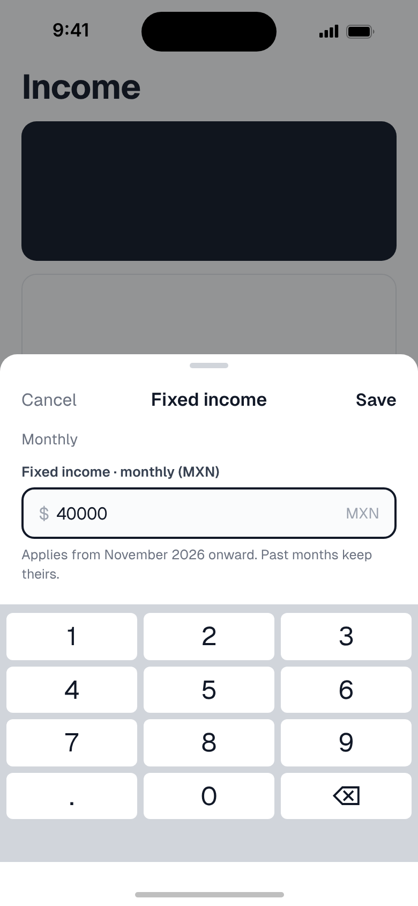

- Inline edit (✓ / ✕) → medium sheet. A number pad needs room; Cancel/Save sit where iOS users expect them.
- Copy kept. "Applies from November 2026 onward. Past months keep theirs."

Source: 02-current-states/income-edit-fixed-mobile.png

## Add variable income · sheet

`Adjusted`

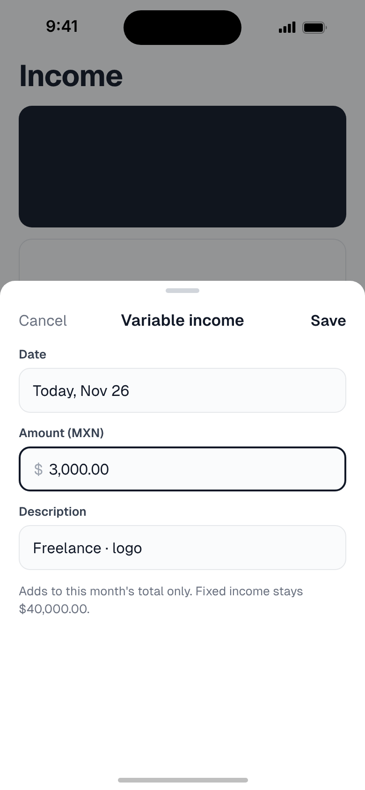

- Web "+ Add" form → sheet. Same fields; date uses the native picker, amount opens the number pad.
- Saved entries list under Variable income with a green +$ amount (as in confirmed V1 Income mock).

Source: 01-current-screens/income-mobile.png · 04-design-mocks/confirmed-v1/income-mobile.png

## Settlement

`Adjusted`

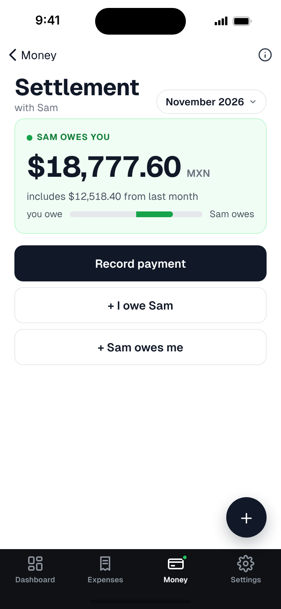

- Kept: hero, gauge, the three actions in the same order. Record payment stays primary.
- ⓘ moves into the nav bar. Opens the Common operations sheet.
- Month control → month pill under the title. Native picker.

Source: 01-current-screens/settlement-mobile.png

## Settlement · scrolled

`Adjusted`

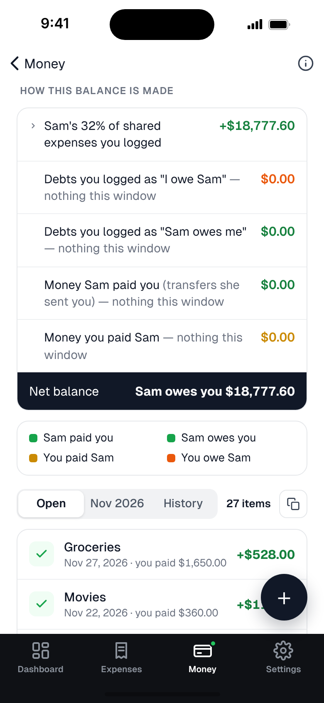

- Kept: every line of "How this balance is made", its colours and the dark Net balance row. Same copy as the web.
- Journal key → compact 2×2 legend. Same four colours and labels, less height.
- Open | Nov 2026 | History → native segmented control. Count and copy button stay to its right; copy uses the iOS share/copy sheet.
- Rows show the full "you paid $1,650.00". No truncation at 390 pt width; tap a row opens the expense.

Source: 01-current-screens/settlement-mobile.png (bottom)

## Record payment · sheet

`Adjusted`

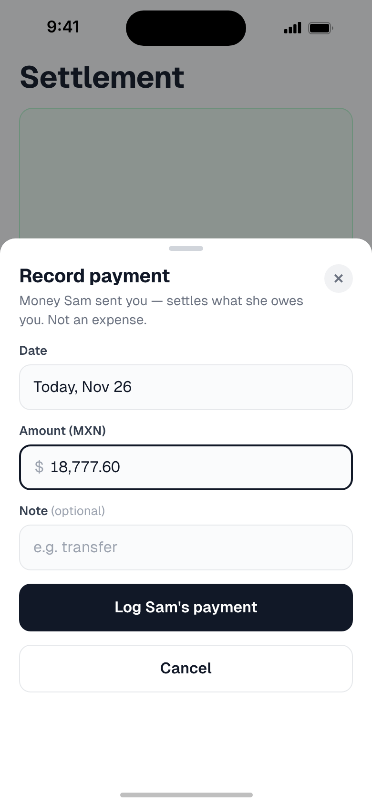

- Dialog → medium sheet. Copy, fields and button label unchanged.
- Amount prefilled with the open balance. As on the web (18777.6), shown formatted.

Source: 02-current-states/settlement-record-payment-mobile.png

## I owe Sam · sheet

`Adjusted`

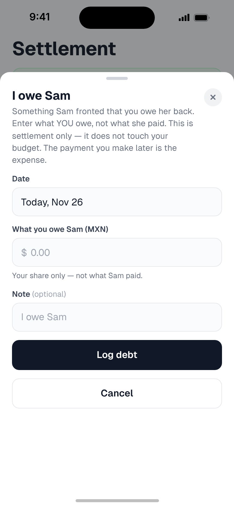

- Dialog → sheet. Full web explanation kept word for word.
- Helper line under the amount label kept. "Your share only — not what Sam paid."

Source: 02-current-states/settlement-i-owe-partner-mobile.png

## Sam owes me · sheet

`Adjusted`

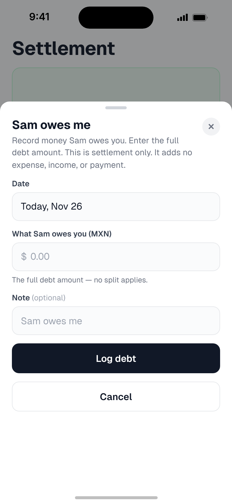

- Dialog → sheet. Full web copy kept.
- "The full debt amount — no split applies." Kept as the field hint.

Source: 02-current-states/settlement-partner-owes-me-mobile.png

## Common operations · sheet

`Adjusted`

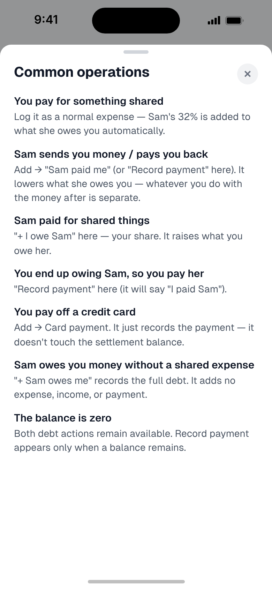

- Help dialog → large sheet from the ⓘ button. All seven items, full copy, same order.
- "Add →" references point at the FAB. The FAB opens the same Add menu the web "+ Add" does.

Source: 02-current-states/settlement-help-mobile.png

## Settlement · History tab

`Proposal`

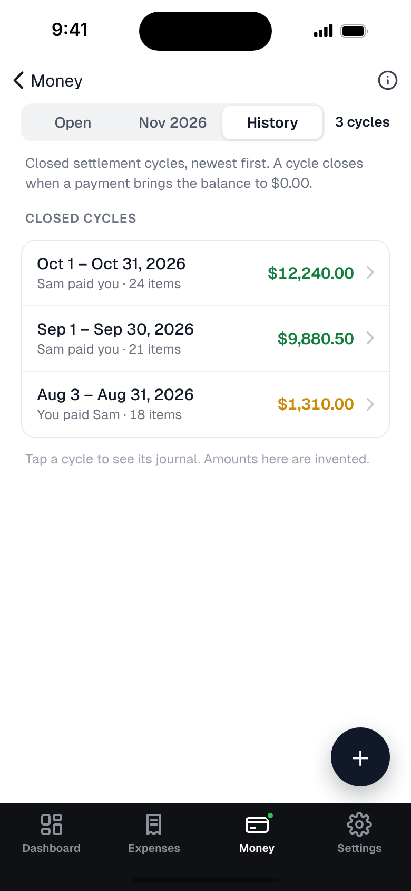

- Inferred. The pack shows the History tab only as a label; this layout is a proposal for closed cycles.
- One row per closed cycle with who paid whom, item count and amount; tap pushes that cycle's journal.
- Needs the real web History screen to confirm. Copy and grouping may differ.

Source: 01-current-screens/settlement-mobile.png (History tab label only)

## Settlement · all settled

`Adjusted`

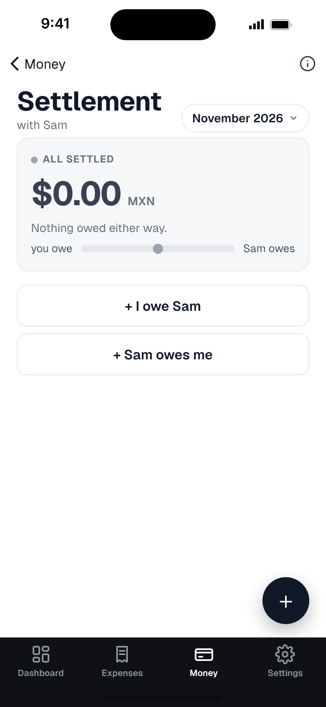

- Grey $0.00 state. Pack rule: green = Sam owes you, grey = settled.
- Record payment hidden. Help copy: "Record payment appears only when a balance remains." Both debt actions stay.
- "All settled" label is inferred. The web shows the state; this exact label needs confirming.

Source: 02-current-states/settlement-help-mobile.png (zero-balance rule)

## Card balances

`Adjusted`

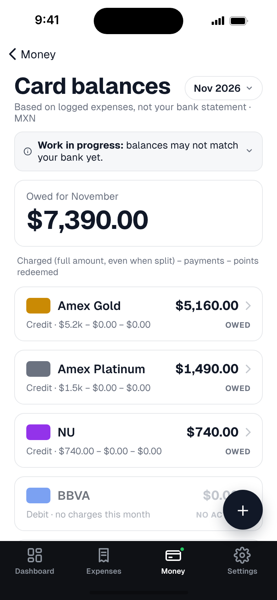

- Kept: subtitle, Owed for November, the "charged − payments − points" formula line, one tile per card with type, mini maths and status. Same numbers.
- Work-in-progress note → one tappable line that expands. Saves ~140 pt; full text and "How this balance works" stay one tap away.
- "+ Add" → FAB. Brief 4.
- BBVA with no charges shows "No activity", muted, last. BUG-10 state.
- Archived cards collapsed at the bottom. v2 mock; names/amounts of archived cards are invented.
- Swipe a tile left → "Log payment". Shortcut to the same sheet.

Source: 01-current-screens/cards-mobile.png · future-card-balances-points.png

## Card balances · archived open

`New · New · Brief 7`

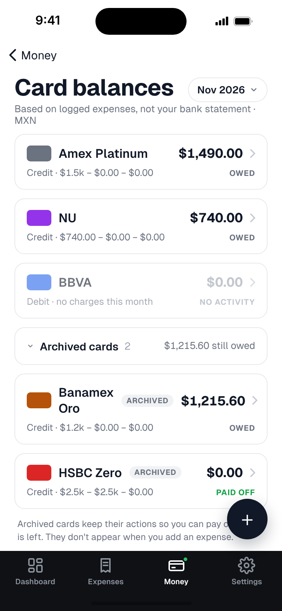

- Tap the Archived header to expand. v2 mock "Archived expanded" state.
- Archived tiles keep Log payment / redemption. So a leftover balance can be paid off.
- Note: shipped code hides archived cards. The mock shows them; decide before build.

Source: 04-design-mocks/future-card-balances-points.png

## Card detail · Amex Gold

`Adjusted`

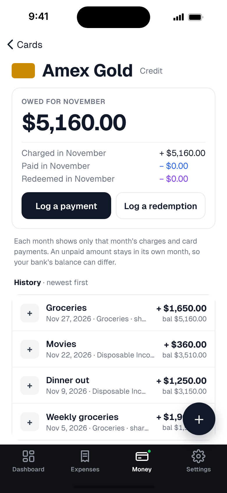

- Right-side drawer → pushed screen. A drawer has no room on a phone; back-swipe returns to the list.
- Kept: Owed for November, Charged/Paid/Redeemed lines, explanation copy, History with running balance. Same numbers.
- Log a payment + new Log a redemption side by side. Brief 7 adds the second action.
- Tap a + row opens that expense. Swipe a payment/redemption row for Edit / Delete.

Source: 02-current-states/cards-balance-drawer-mobile.png · future-card-balances-points.png

## Log a payment · sheet

`Adjusted`

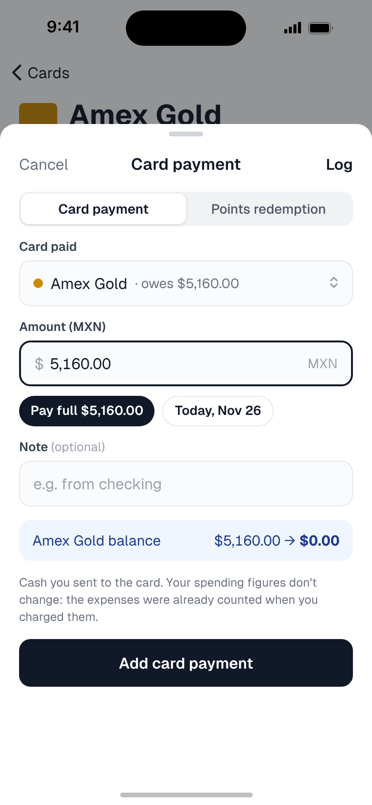

- Dialog → sheet using the Add pattern. v2 mock: card prefilled from the screen it was opened on.
- "Pay full $5,160.00" and the date become chips. One tap each; date chip opens the native picker.
- Kept: blue balance preview and the "Cash you sent to the card…" note. A card payment never changes spending.

Source: 02-current-states/cards-log-payment-mobile.png · future-card-balances-points.png

## Log a points redemption · sheet

`New · New · Brief 7`

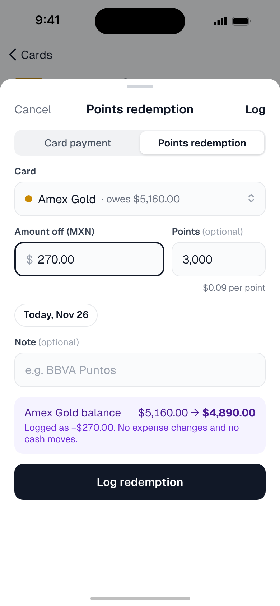

- CHORE-24. Lowers the card balance only; spend, budget, buckets and categories do not change.
- Amount in MXN required; points and note optional. With points filled, shows value per point (3,000 pts for $270 = $0.09).
- Same sheet as Log a payment, other segment. Also reachable from Add → Points redemption.

Source: 04-design-mocks/future-card-balances-points.png · 05-future-screens.md Brief 7

## Card detail · after a redemption

`New · New · Brief 7`

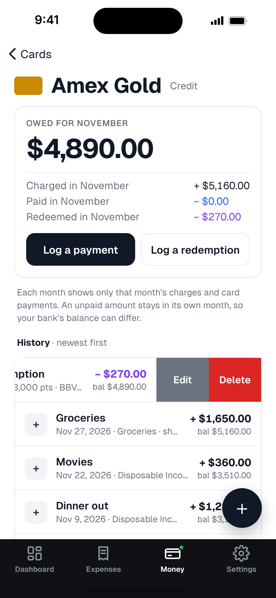

- Redeemed in November − $270.00 (violet). Balance = charged − payments − points redeemed = $4,890.00.
- ★ row in History, its own −$ line like a payment. Running balance updates.
- Swipe left on a redemption → Edit / Delete. Mirrors card payment edit (Brief 7).

Source: 04-design-mocks/future-card-balances-points.png

## Card tile states · reference

`New · New · Brief 7`

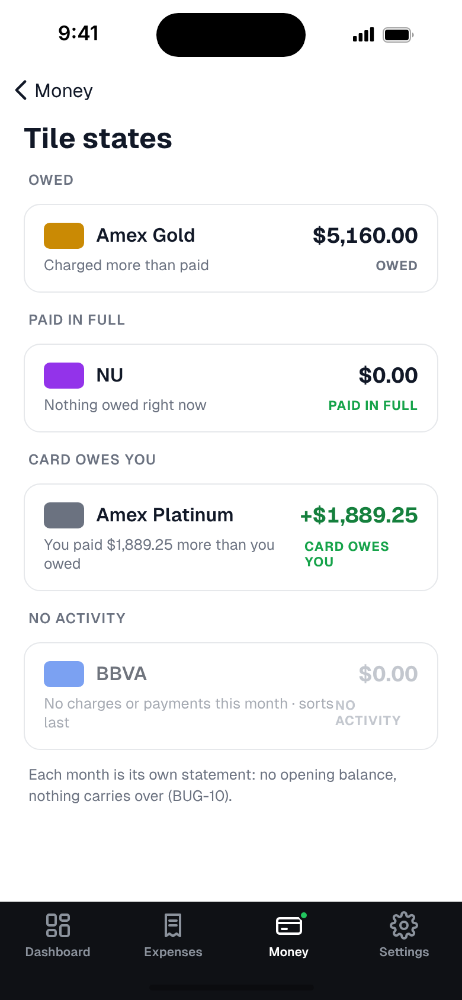

- Four states from the v2 mock + BUG-10. Owed, Paid in full, Card owes you (+ and green), No activity (muted, last).
- Reference artboard, not a screen. Amounts for the last two states are from the v2 mock.

Source: 04-design-mocks/future-card-balances-points.png · 05-future-screens.md Brief 7

## Card balances · no cards yet

`New · New · Brief 7`

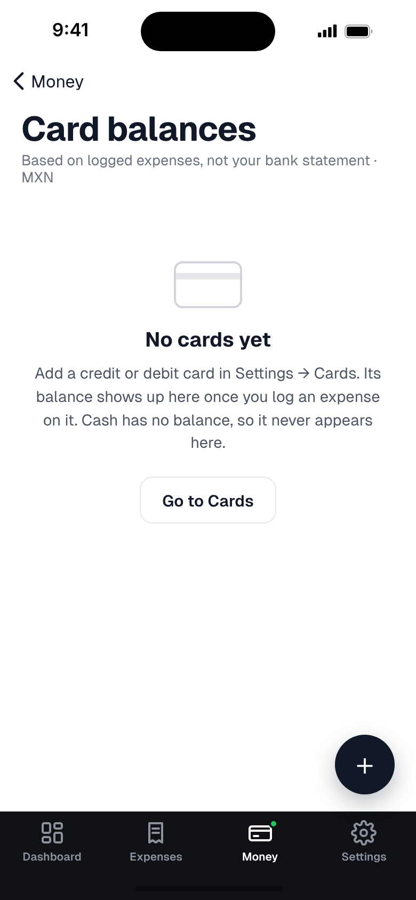

- Empty state from the v2 mock. Same message as desktop; "Go to Cards" pushes Settings → Cards.

Source: 04-design-mocks/future-card-balances-points.png

## Savings

`Proposal`

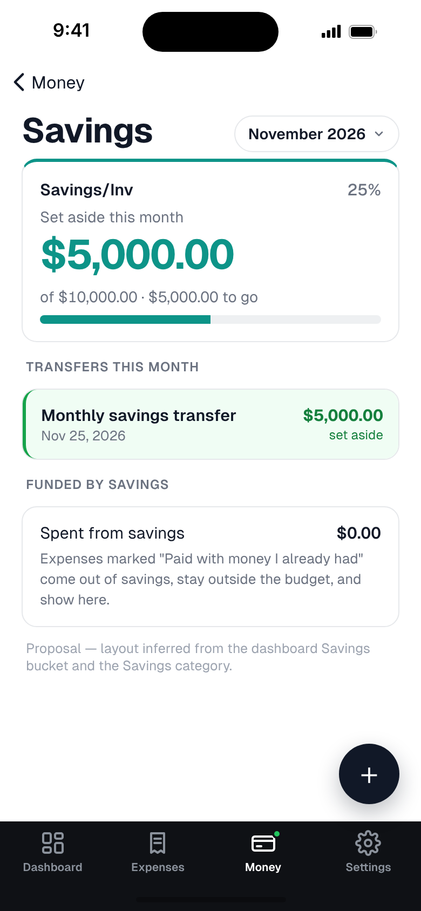

- No screenshot of the web Savings page is in the pack. This is a proposal; it needs the real web Savings screen to confirm before build.
- Built from shipped data: Savings/Inv bucket 25% ($5,000.00 of $10,000.00, $5,000.00 to go) and the Monthly savings transfer row (green, "set aside").
- "Funded by savings" line ties to "Paid with money I already had" on the expense form; $0.00 this month.

Source: 01-current-screens/dashboard-mobile.png (Savings bucket) · expenses-mobile.png (transfer row)
