# Settings

Exported from the FET design canvas, page "iOS app 5 Settings". iPhone 390×844 pt, PNG @2x (780×1688).

Badges: **Kept** = same as the web phone view · **Adjusted** = same content, native changes · **New** = planned feature (brief) · **Proposal** = inferred, needs a decision.

## Settings

`Adjusted`

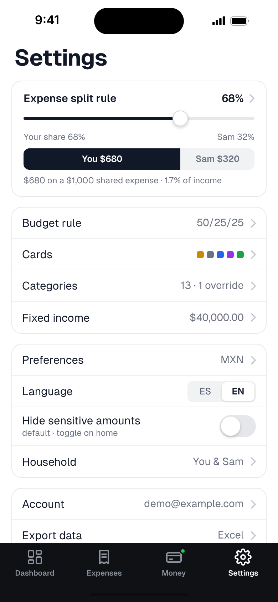

- One long page → grouped list. Each web card becomes a row that pushes its own screen; the list scrolls (Export, Privacy policy and Sign out sit below the fold).
- Split rule stays on top as a live card. Same order as the web and the Settings mock; tap pushes the full editor.
- "More settings · coming soon" chips removed. Category limits, Preferences, Privacy and Account become real rows (briefs 1, 6, 10).
- Sign out moves here from the sidebar footer. The burger drawer is gone on iOS.

Source: 01-current-screens/settings-mobile.png · 04-design-mocks/future-settings-privacy-account.png

## Expense split rule

`Adjusted`

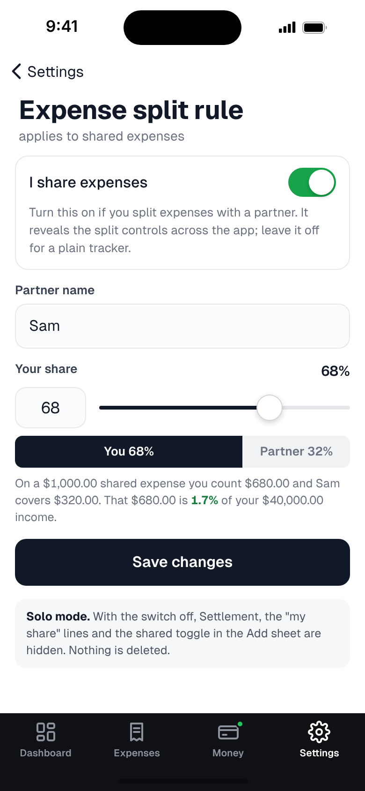

- Checkbox → iOS switch. Native control for an on/off rule.
- Number field + slider. The web field stays for exact entry; the slider (from the Settings mock) is easier with a thumb.
- Income-slice line added from the mock. Uses the real $40,000.00 fixed income.
- Save is full width. Easier to reach than the web's right-aligned button.

Source: 01-current-screens/settings-mobile.png · future-settings-privacy-account.png

## Budget rule

`Adjusted`

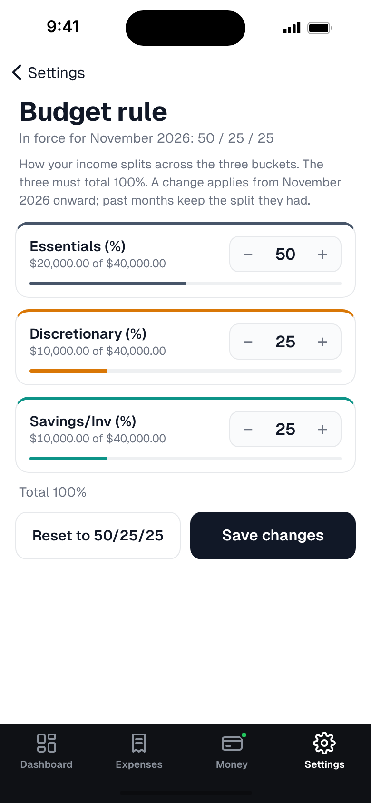

- Number fields → steppers. Tap ± in 1% steps or tap the number for the number pad.
- Peso target under each bucket. Shows what the % means against $40,000.00 (the Settings mock says fixed income drives the peso targets).
- 3px bucket tops, copy and "Total 100%" kept. Same colour system as the web.

Source: 01-current-screens/settings-mobile.png · 03-onboarding/05-your-budgeting-rule-mobile.png

## Budget rule · total ≠ 100%

`Adjusted`

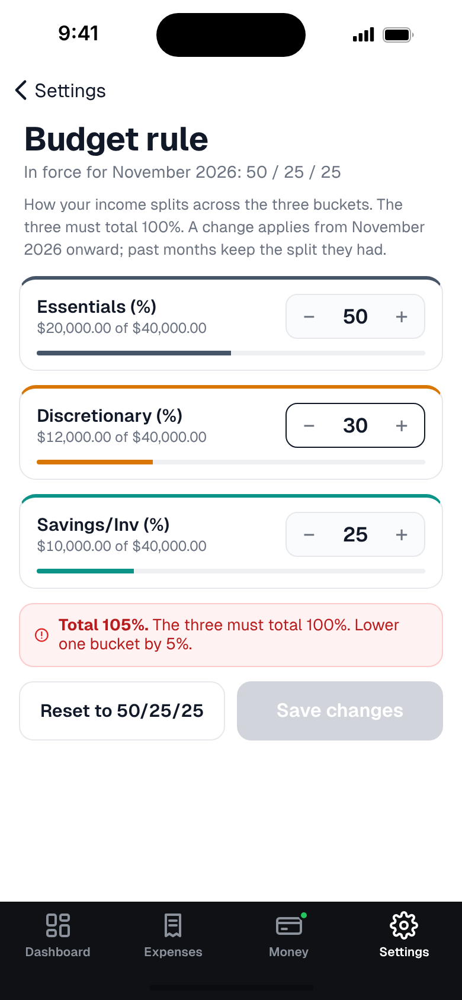

- "Total" line turns into an inline error. Same rule as the web (must total 100%); Save stays disabled until it does.
- No auto-balancing. The app never moves another bucket for you; the user decides which one gives.

Source: 01-current-screens/settings-mobile.png (validation rule from the Budget rule copy)

## Cards

`Adjusted`

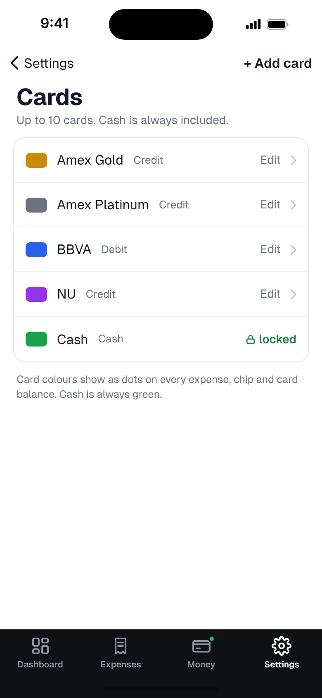

- Card section → its own pushed list. Same order, type labels and the green "locked" Cash row.
- "+ Add card" moves to the nav bar. Standard iOS place for a create action.
- Inline edit form → sheet. Tapping a row opens the Edit card sheet instead of expanding in place.

Source: 01-current-screens/settings-mobile.png · 02-current-states/settings-edit-card-desktop.png

## Add card · sheet

`Adjusted`

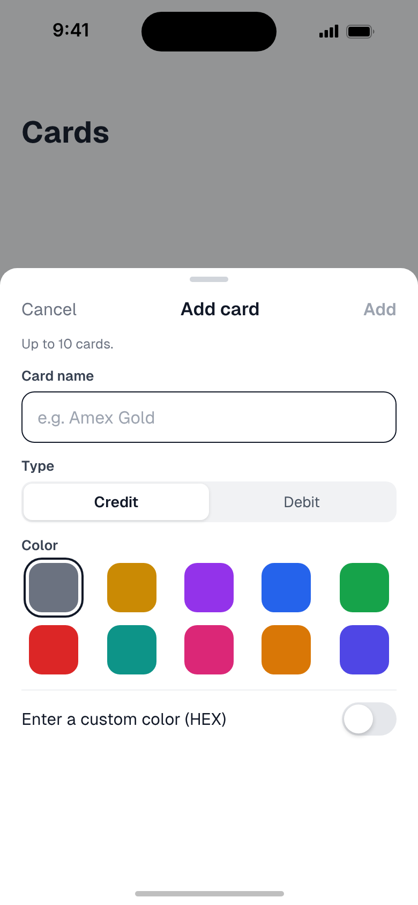

- Inline form → medium sheet. Cancel / Add in the header replace the bottom buttons.
- Type select → segmented control. Two options fit on one line.
- Same 10 swatches, bigger. 46 pt targets; the custom HEX checkbox becomes a switch.

Source: 02-current-states/settings-add-card-mobile.png · 03-onboarding/06-add-a-payment-method--mobile.png

## Edit card · sheet

`Adjusted`

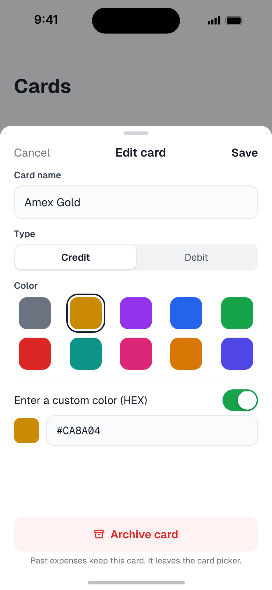

- Inline edit row → sheet. Same fields as the web edit state (name, type, colour, custom HEX, Archive).
- Archive moves to the bottom. Destructive action kept away from Save; the caption explains what it does.
- Custom HEX shown on. Hex in Geist Mono with a live swatch.

Source: 02-current-states/settings-edit-card-desktop.png

## Categories

`New · Brief 6`

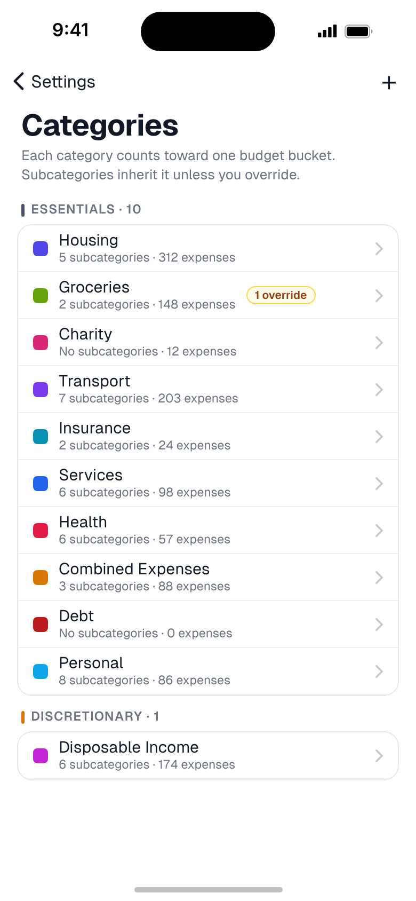

- Replaces the "Category limits · coming soon" chip. Settings › Categories shows "13 · 1 override".
- Grouped by bucket (1a), one row per category. The web's bucket chip becomes the group header; tap a row to open it.
- Amber "1 override" badge marks a category whose subcategory counts elsewhere.
- "+" in the nav bar opens New category. Savings, Unassigned and Archived sit lower (see the scrolled frame).

Source: 04-design-mocks/future-category-management.png · html/categoryManagement.html

## Category · Groceries

`New · Brief 6`

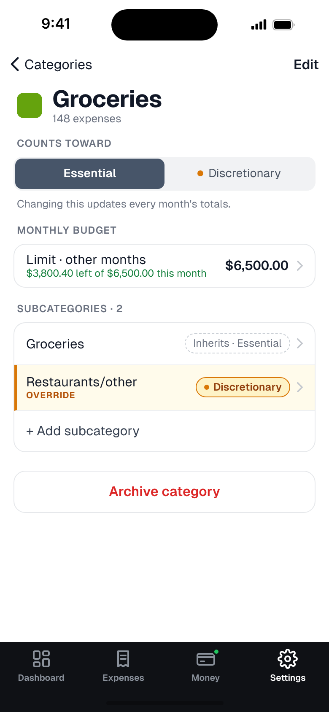

- Bucket chip → 2-option segmented control, as the mock specifies. Tapping the other side opens the confirmation sheet.
- Inherits = dashed chip; override = amber rail, OVERRIDE label, filled chip. Same visual rules as desktop.
- Monthly budget row shares the dashboard's set-limit path (same "No limit / default" sheet).
- Rename & recolour from "Edit" in the nav bar; Archive or Delete as the bottom button.

Source: future-category-management.png (mobile · category detail) · 02-current-states/category-edit-limit-mobile.png

## Subcategory override · sheet

`New · Brief 6`

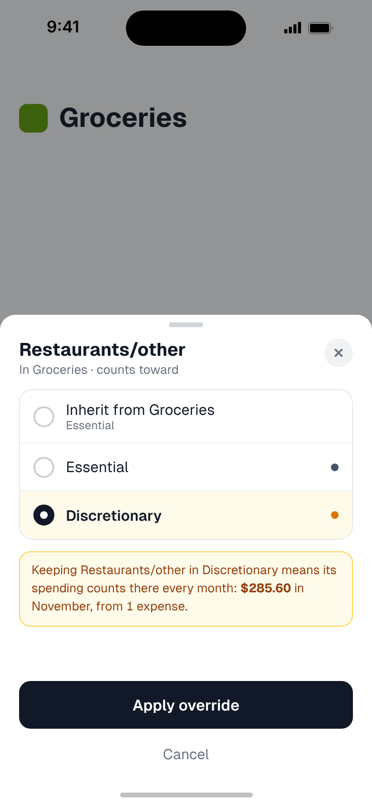

- Desktop popover → medium bottom sheet (mock: "override as a bottom sheet").
- Three choices, plain-words impact line, nothing changes until Apply. Picking "Inherit" is the "Reset to inherit" action.
- Impact uses the real month: Tacos, $285.60 my share, is the only Restaurants/other expense in November.

Source: future-category-management.png (setting a subcategory override)

## Bucket-change confirmation

`New · Brief 6`

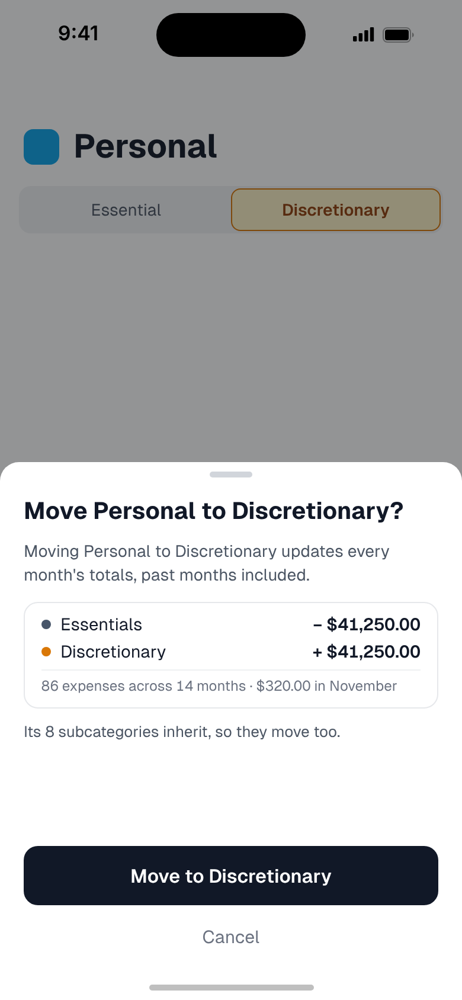

- Desktop dialog → bottom sheet. The segment shows the pending choice; it only commits after "Move to Discretionary".
- Peso shift, expense count and the subcategories that move along — all fields the brief asks for. Overrides stay where they are.
- All-months figures are the mock's (demo history isn't in the pack); November uses the real $320.00.

Source: future-category-management.png (bucket-change confirmation)

## Rename & recolour · sheet

`New · Brief 6`

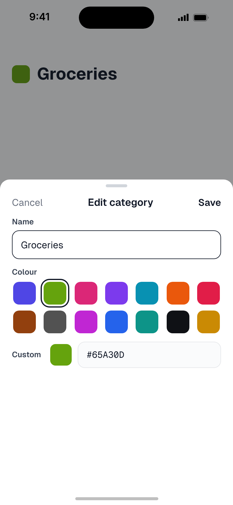

- Row menu "Rename & recolour" → sheet from the nav bar Edit.
- Same swatches + hex as Cards, per the brief; the new colour updates every chip, bar and rail.

Source: future-category-management.png (edit name & color)

## New category · full-height sheet

`New · Brief 6`

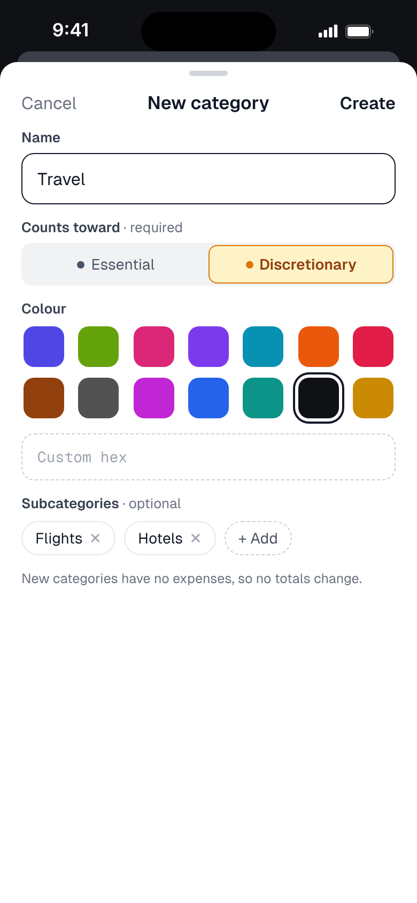

- "+ Add category" → full-height sheet from the list's "+" (as the mock says).
- Bucket is required (Essential or Discretionary only — Savings and Unassigned are fixed). Create stays disabled without it.
- Subcategories as removable chips; they inherit the new bucket.

Source: future-category-management.png (add category)

## Archive vs delete · action sheet

`New · Brief 6`

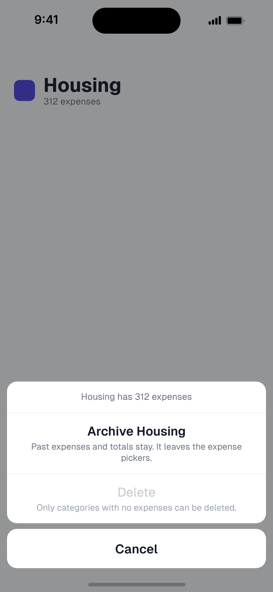

- Row menu → native action sheet from the "Archive category" button.
- With expenses: Archive only, Delete shown disabled with the reason. With 0 expenses (e.g. Debt): Delete is red, then a "This can't be undone" alert.

Source: future-category-management.png (archive vs delete)

## Categories · scrolled, Archived open

`New · Brief 6`

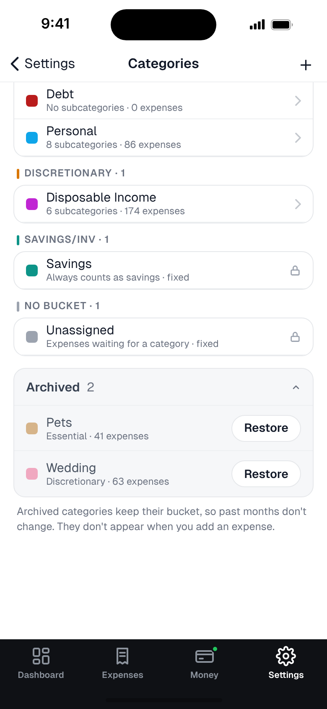

- Savings and Unassigned show a lock, no chevron and no menu (fixed buckets).
- Collapsed "Archived (2)" at the end; here it's open. Restore returns a category to its group.
- Pets and Wedding are the mock's archived examples (no archived categories exist in the demo data).

Source: future-category-management.png (archived list)

## Preferences

`New · Settings mock`

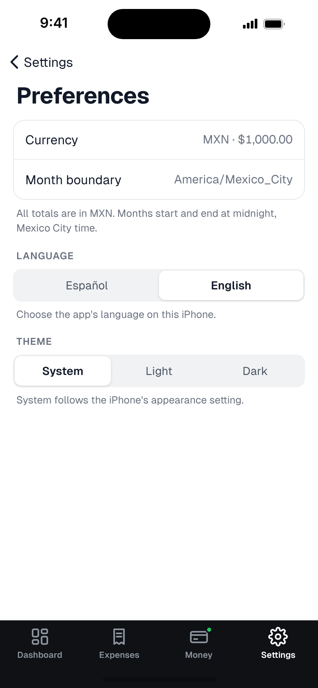

- Replaces "Preferences · coming soon". Fields from the Settings mock: Currency, Month boundary, Language, Theme.
- Currency is read-only. Spec 0006 §8 defers a per-account currency.
- Language moves here from its own web card and now applies per iPhone, not per browser. Theme needs a dark palette that isn't designed yet.

Source: future-settings-privacy-account.png · settings-mobile.png (Language card)

## Privacy

`New · Brief 1`

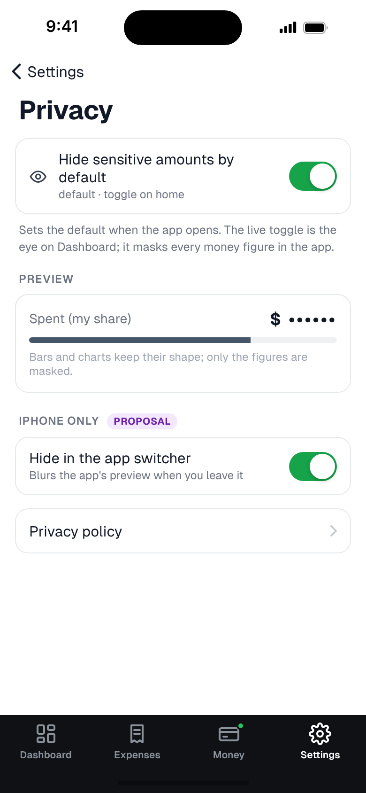

- Slice 2.8 (P12). Default lives here; the eye on Dashboard flips it for the whole app. Masked format $ •••••• .
- localStorage → on-device preference (UserDefaults); persists across launches.
- Proposal: blur in the app switcher, from the brief's "(inferred)" native note.

Source: 05-future-screens.md Brief 1 · future-settings-privacy-account.png

## Recurring expenses

`New · Brief 2`

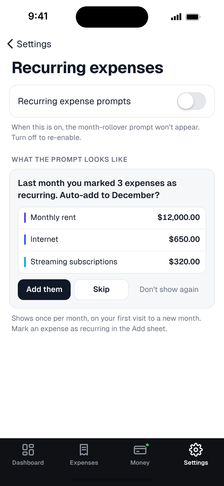

- Slices 3.1–3.4. Toggle and help copy exactly as the brief; preview shows the rollover sheet (designed in 3 · Expenses).
- Copy needs a decision: the brief's help text describes a "suppress" switch (on = no prompt) but the label reads "prompts". Suggest label "Skip month-rollover prompt", or flip the help text. Shown off = prompts appear.
- Example rows are the demo's fixed bills (rent, internet, streaming) — which ones are flagged is invented.

Source: 05-future-screens.md Brief 2

## Weekly summary

`New · Brief 5 · Proposal`

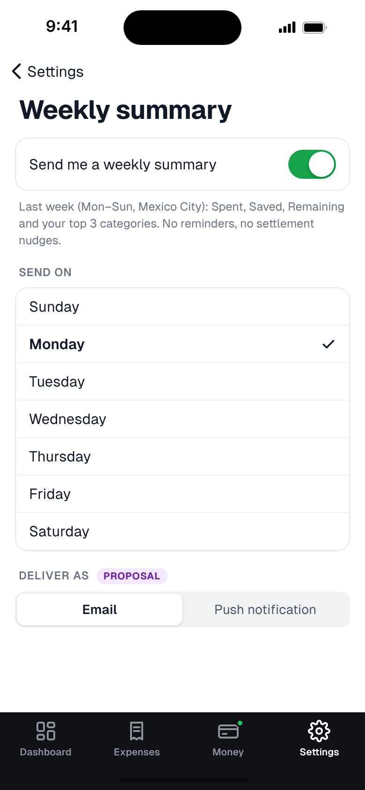

- Slices 7.1–7.4 (phase may be skipped). Day Sun–Sat, default Monday; switch off = emailDay null .
- Placement inferred ("day configurable from Settings").
- Proposal: deliver as a push instead of email. Spec 0001 lists push as out of scope, so this needs a decision.

Source: 05-future-screens.md Brief 5

## Export data · share sheet

`Adjusted`

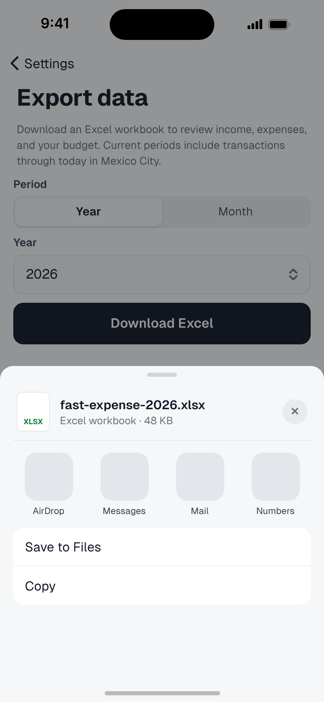

- Browser download → iOS share sheet. Save to Files, AirDrop, Mail or open in a spreadsheet app.
- Period select → segmented control; Year → wheel picker. "Month" adds a month picker under Year.
- Copy and the Mexico City cut-off kept. File name and size are illustrative.

Source: 01-current-screens/settings-mobile.png (Export data card)

## Account

`New · Brief 10`

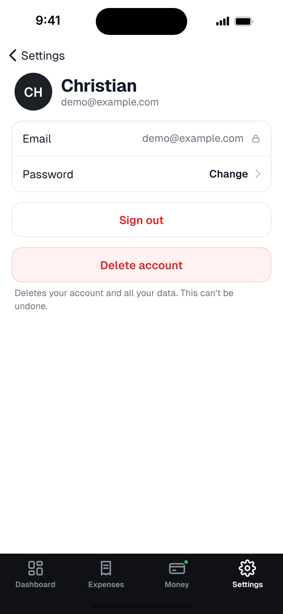

- Replaces "Account · coming soon". Email (read-only), Password "Change", Sign out — as in the Settings mock.
- Delete account added (CHORE-36); separated and tinted so it can't be hit by mistake.
- The sidebar's avatar + name moves here.

Source: future-settings-privacy-account.png (Account) · 02-current-states/nav-drawer-mobile.png

## Change password · error state

`New · Brief 10`

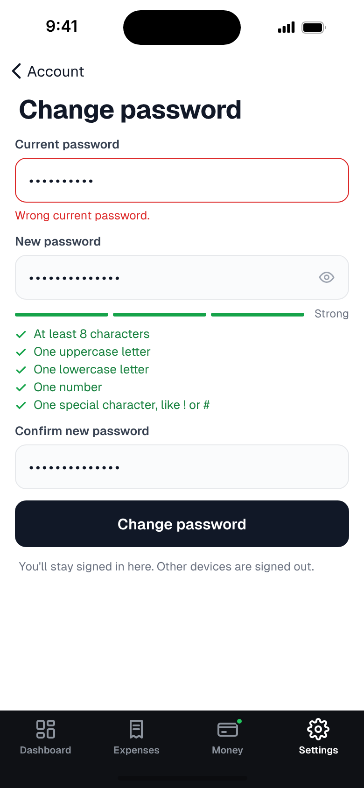

- Same signup rules + live checklist as the web signup form.
- Errors: "Wrong current password." · "Must be different from your current password." · weak (checklist items turn grey) · "Passwords don't match."
- Inferred: spec 0009 keeps one web /login , so this may open the web page in a browser sheet instead of a native form.

Source: 05-future-screens.md Brief 10 · 03-onboarding/00-signup-filled-mobile.png (checklist)

## Delete account · step 1

`New · Brief 10`

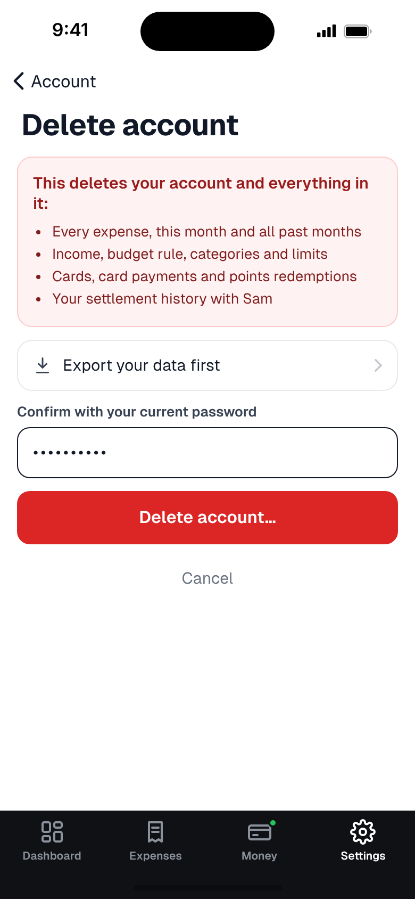

- CHORE-36. Confirm with the current password (shares the session check with change password).
- Lists what goes, in the app's own words, and offers Export first. Wording is inferred — no mock.

Source: 05-future-screens.md Brief 10

## Delete account · final alert

`New · Brief 10 · Proposal`

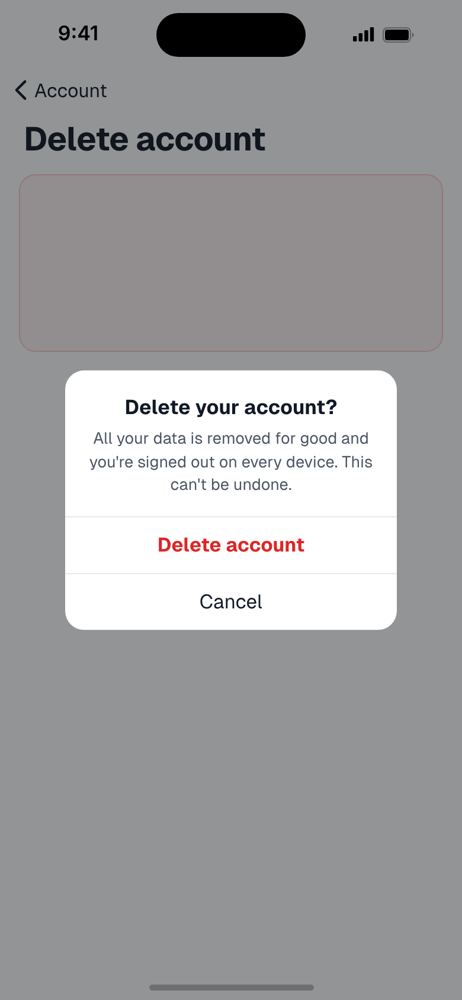

- Native alert for the irreversible step; Delete is red and listed first, Cancel is the safe default.
- Proposal: the brief marks this wording "(inferred)". After delete the session ends and the app returns to the sign-in screen.

Source: 05-future-screens.md Brief 10

## Sign out · confirm

`Adjusted`

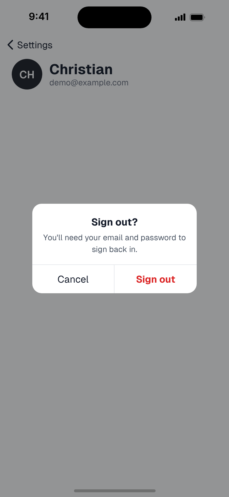

- Sidebar sign-out icon → confirm alert. On a phone a stray tap would cost a browser-sheet sign-in, so it asks once.
- Signs out this device only; tokens are cleared from the Keychain.

Source: 02-current-states/nav-drawer-mobile.png (sign-out icon)

## Privacy policy

`New · Brief 11`

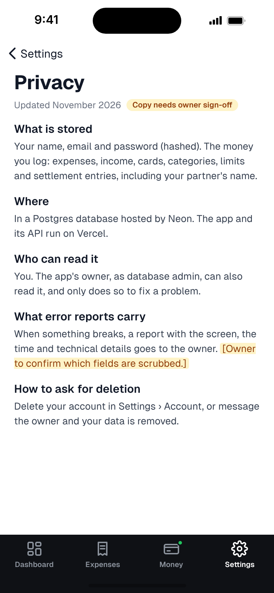

- CHORE-37. Short plain sections in the brief's order. Copy is a draft for the owner.
- Also opens signed out from Sign up (as a sheet, no tab bar) and is the URL the App Store requires.
- Web page shown natively so it reads like the rest of Settings; it can also load the public web page.

Source: 05-future-screens.md Brief 11
