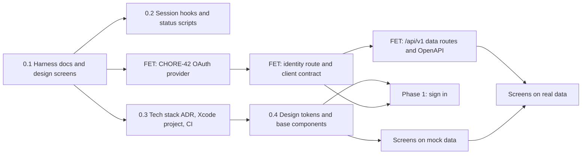

# Foundation plan

Written 2026-11-27 by the planning session. It records what we found on day 1, what we
decided, and the order of the first work. Delete it when Phase 0 is done and its content
lives in the roadmap and the ADRs.

## Goal

Turn FET into a native iPhone app that reuses the FET backend. Before any feature work, get
this repo ready for agent-led development: instructions, limits, subagents, a place for
plans, specs, slices and design screens, and GitHub access.

## What we found

| Item | State on 2026-11-27 |
| --- | --- |
| This repo | Empty. Public. Remote `Chrisgmsl22/fast-expense-tracker-ios-app` |
| FET auth | Better Auth is merged (CHORE-41, PR #107) |
| FET native login | Not built. CHORE-42 (OAuth 2.1 provider, consent page, iOS client entry) is open |
| FET data API | Not built. FET has `/api/auth/*` and `/api/financial-export` only. All data goes through 41 server actions |
| Designs | 103 screens in 5 sections, App Store assets, Claude Design source files |
| Tools on the Mac | Xcode 26.5, Swift 6.3, XcodeGen. No SwiftLint, no SwiftFormat |
| GitHub | SSH push works. `gh` has a fine-grained token for this repo and FET |

The main finding: **the app cannot read or write expense data today.** Login and data both
wait on FET work. See [`backend-contract.md`](../reference/backend-contract.md).

## Decisions made

| Decision | Record |
| --- | --- |
| Login by OAuth 2.1 with PKCE in the system browser sheet, data from `/api/v1`, client generated from OpenAPI | [ADR-0001](../decisions/0001-backend-contract-oauth-pkce-and-api-v1.md) |
| One planning session (the mind), one session per feature on Opus at medium effort, agents open PRs, Christian merges | [ADR-0002](../decisions/0002-agent-led-development-and-session-model.md) |
| Plans, specs, slices and screens live in this repo | [ADR-0003](../decisions/0003-docs-and-specs-live-in-the-repo.md) |
| The repo structure in `doc-structure.md` | [`doc-structure.md`](../conventions/doc-structure.md) |
| Keep the Claude Design source files in the repo | ADR-0003 item 3 (default, Christian can reverse it) |

## Decisions still open

All of these belong to Christian. They are listed in
[ADR-0004](../decisions/0004-tech-stack.md): minimum iOS version, OAuth client, app
architecture, offline behavior, Apple Developer account, languages.

One more: **the order of backend work.** The auth delivery plan in FET builds CHORE-42,
then the identity route and the client contract. The `/api/v1` data routes are not
registered. Someone must design that route list. The iOS screens are the input.

## Order of work

Two tracks run in parallel after 0.1:

- **iOS track** (this repo): 0.2, 0.3, 0.4, then screens on mock data.
- **Backend track** (FET repo): CHORE-42, the identity route, then `/api/v1`.

The tracks meet at sign-in. Phase 1 needs both 0.4 and the FET client contract.

## What 0.1 delivers

- `AGENTS.md`, `.claude/settings.json`, the `implementer` and `reviewer` subagents.
- Conventions: agent workflow, slice planning, PR strategy, doc structure.
- ADR-0000 to ADR-0003 accepted, ADR-0004 proposed.
- The roadmap index, `slices.json`, the Phase 0 file.
- The backend contract and the domain reference.
- The 103 design screens under `docs/design/`.

## What 0.1 leaves out, on purpose

- Hooks and status scripts. They need the registers to exist first. Slice 0.2.
- CI. There is nothing to build yet. Slice 0.3.
- Swift conventions. They depend on ADR-0004. Slice 0.3.
- A slice list past Phase 0. Phases 1 to 6 are named in the roadmap, and each gets sliced
  when it becomes next.

## Risks

- **The backend track is the long pole.** `/api/v1` covers every area the web app has. If
  it lags, the iOS track runs out of work that does not need it.
- **Mock data can drift from the real API.** Generate the mock from the OpenAPI document as
  soon as a draft of it exists, even before the routes work.
- **Many screens are for features that the web does not have yet.** 40 or more screens have
  the badge New or Proposal. Each needs its backend feature first. Phase order puts Kept
  and Adjusted screens first.
