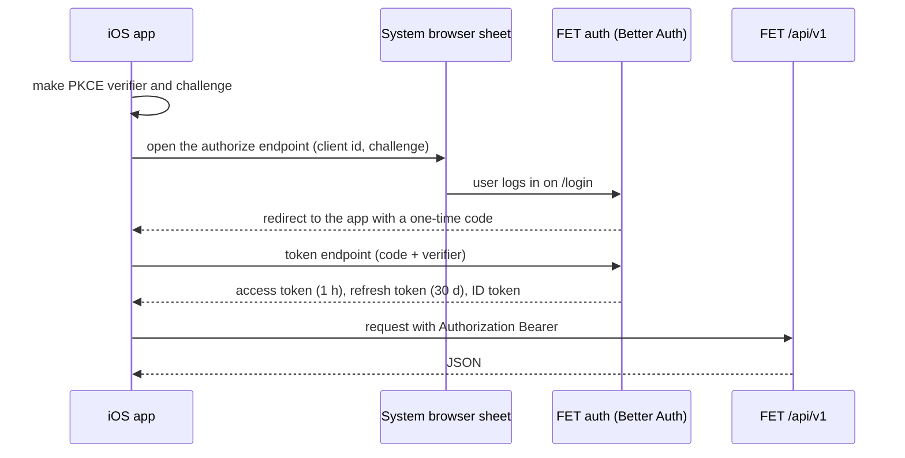

# Backend contract

How this app talks to the FET backend, and which parts of that backend exist. Checked
against FET `origin/main` at commit `4692c39` on 2026-11-27. Update this file in the same
PR as any change to it.

The decision is [ADR-0001](../decisions/0001-backend-contract-oauth-pkce-and-api-v1.md).
The source of truth for the backend is the FET repo, not this file.

## The flow

- The access token is a JWT. The API checks its signature, issuer, audience and expiry.
- The refresh token rotates on every use. A reused refresh token ends its whole family, so
  the app must never send the same refresh token twice.
- Lifetimes are the plugin defaults in FET ADR-0028: 1 hour and 30 days.

## What exists in FET

| Piece | State on 2026-11-27 | FET item |
| --- | --- | --- |
| Better Auth as the login system | Merged | CHORE-41, PR #107 |
| `/api/auth/*` (Better Auth handler) | Live. Cookie sessions for the web | CHORE-41 |
| OAuth 2.1 provider, JWKS, consent page, iOS client entry | **Not built** | CHORE-42, open |
| Identity route, tentatively `GET /api/v1/me`, and the written client contract | **Not built** | `fet-feat-mobile-auth-contract`, in the auth delivery plan |
| `/api/v1` data routes and the OpenAPI document | **Not built, not registered** | Spec 0009, PR 5 (`fet-feat-api-v1`) |
| `/api/financial-export` | Live, cookie session only | Spec 0011 |

All data reads and writes in FET today are Next.js server actions (41 files under
`app/_actions/`, in the areas account, auth, card, category, expense, income, locale,
movement, settings, settlement). A Swift app cannot call a server action. Each area that a
screen needs must get an `/api/v1` route first.

## What this means for iOS work

- Sign-in cannot work end to end until CHORE-42 and the identity route merge and deploy.
- No screen can show real data until its `/api/v1` routes exist.
- A screen can be built first on mock data. Its Plan block must say so, and must name the
  FET item that replaces the mock.
- The list of `/api/v1` routes is not designed yet. The iOS screens are the input for that
  design: each section in `docs/design/` implies a set of reads and writes.

## Values the app needs from FET

None of these exist yet. They come from the FET client contract.

| Value | Source | Secret |
| --- | --- | --- |
| API base URL, per environment | FET deployment | No |
| OAuth issuer and endpoints | FET discovery document | No |
| Client id | The iOS client entry from CHORE-42 | No. The client is public |
| Redirect URI (private-use scheme) | Chosen with CHORE-42, registered in the app | No |
| Scopes | FET client contract | No |

The app holds no secret at build time. The only secrets are the user's tokens, and they
live in the Keychain.

## Rules for backend work

- Backend changes are FET work items. They run in the FET repo under FET's `AGENTS.md`.
- A merge in FET deploys to production and can run a migration on real financial data.
  Christian merges there too.
- When a design needs something the API cannot do, the feature session stops and reports.
  It does not work around the gap on the phone.
